# Topic 02: Operating System Overview

## Overview
An OS controls the execution of applications and sits between them and the hardware. This lecture covers what an OS is for, the services it gives, how OSes evolved (serial, batch, multiprogramming, time sharing), the five major themes of OS design, modern OS features (microkernel, threads, SMP, distributed, object-oriented), and the structure of Windows and UNIX. (Slides 1-3)

## Operating system: definition and objectives (Slides 4-6)
- Definition 1: a program that controls execution of application programs; an interface between applications and hardware.
- Definition 2: exploits the hardware of one or more processors, provides services to users, manages secondary memory and I/O devices.
- Objectives: **convenience** (easier to use), **efficiency** (resources used well), **ability to evolve** (new functions can be developed, tested and introduced without disrupting service).
- Layers of a computer system (slide 6, Fig 2.1): computer hardware at the bottom, then the operating system, then utilities, then application programs. The end user sees the application programs, the programmer sees utilities and the OS, and the OS designer sees the OS and the hardware. The OS hides hardware detail from the layers above.

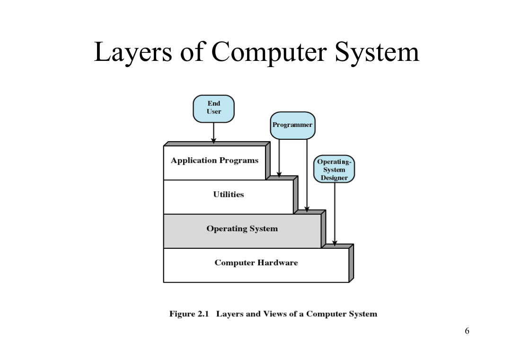

## Services provided by the OS (Slides 7-9)
- Program development (editors, debuggers), program execution, access to I/O devices, controlled access to files, system access.
- Error detection and response: hardware errors (memory error, device failure) and software errors (arithmetic overflow, access to forbidden memory); the OS may also be unable to grant a request.
- Accounting: collect usage statistics, monitor performance, anticipate future enhancements, billing.

## The OS as a resource manager (Slides 10-12)
- The OS manages resources but is itself just a program that is executed by the processor.
- It frequently gives up the processor and relies on the processor to let it regain control (e.g. via interrupts/timer).
- Slide 11 (Fig 2.2): memory holds the OS software and the programs and data; I/O controllers connect the I/O devices; processors execute both. The OS manages these resources.
- **Kernel** (also called the **nucleus**): the portion of the OS held in main memory, containing the most frequently used functions.

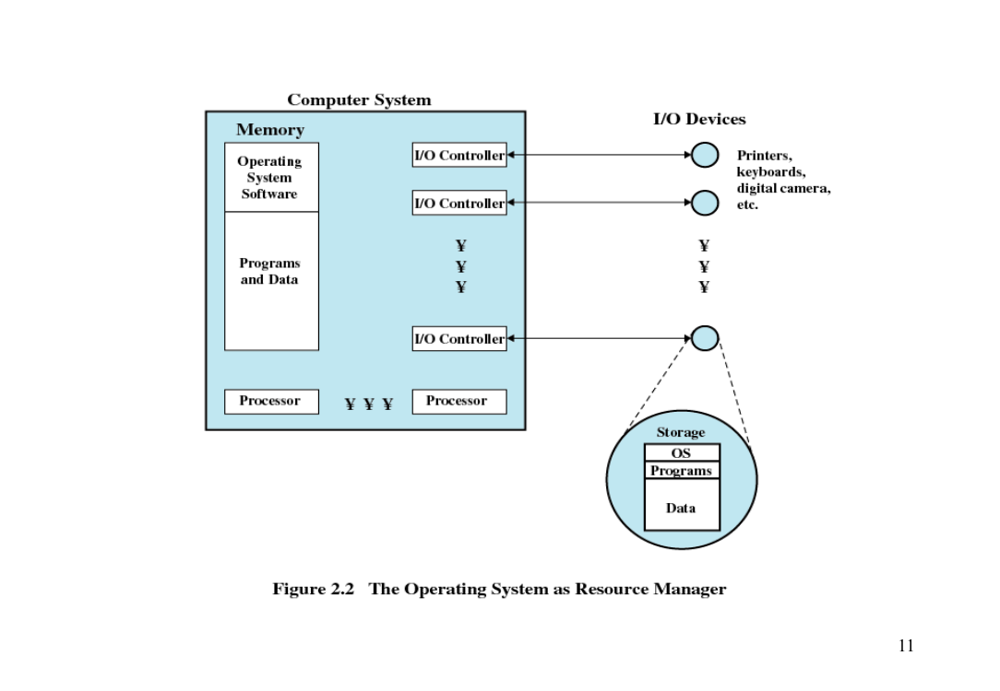

## Evolution of operating systems (Slides 13-25)
- **Serial processing**: no OS; programmer works from a console (lights, toggle switches, input device, printer); time is scheduled in advance; setup (load compiler, source, save compiled program, load and link) wastes time.
- **Simple batch systems**: a **monitor** (resident software) controls the sequence of events; jobs are batched together; each job branches back to the monitor when finished.
- Hardware features needed for the monitor:
  - **Memory protection**: the monitor's memory area cannot be altered by user programs.
  - **Timer**: stops a job monopolising the system.
  - **Privileged instructions**: some machine instructions can only be run by the monitor.
  - **Interrupts**: absent in early machines.
- **User mode vs system (kernel) mode**: user programs run in user mode where some instructions are forbidden; the monitor runs in system/kernel mode where privileged instructions run and protected memory is accessible.
- **I/O devices are slow** (slide 18): in the textbook example a record costs 15 µs to read, 1 µs to execute 100 instructions and 15 µs to write, 31 µs in total, so CPU utilisation is 1/31 = 3.2% (Figure 2.4).
- **Uniprogramming**: the processor waits for each I/O instruction to complete before continuing.
- **Multiprogramming**: when one job waits for I/O, the processor switches to another. Slides 21-23 show run/wait timelines for 1, 2 and 3 programs, then a worked example (three jobs: JOB1 compute-heavy, JOB2 and JOB3 I/O-heavy) with utilisation histograms. Result in the textbook: running them together roughly doubles CPU, disk and printer utilisation and throughput (6 to 12 jobs/hr) and halves elapsed time (30 to 15 min).
- **Time sharing**: multiprogramming applied to interactive jobs; the processor's time is shared among users who access the system simultaneously through terminals.
- **CTSS** (Compatible Time-Sharing System): first time-sharing system, developed at MIT. Slide 25 (Fig 2.7) shows its memory (32000 words, the first 5000 for the monitor) with one user job at a time in memory and the others swapped out.

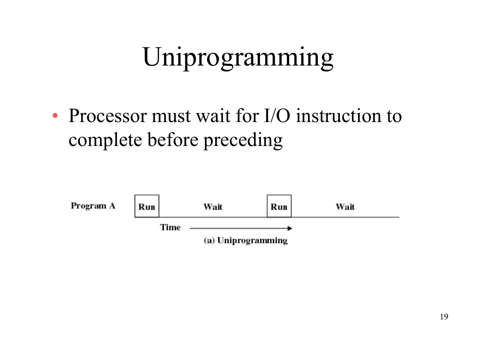

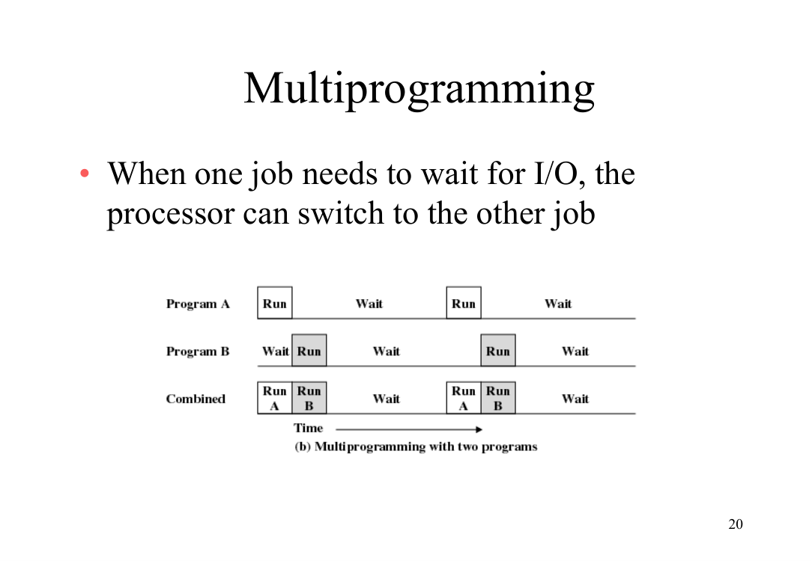

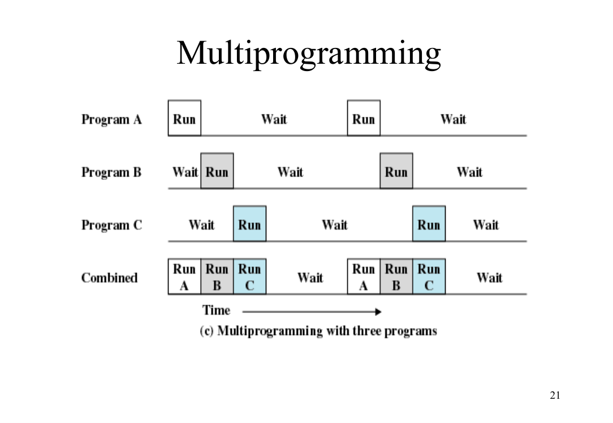

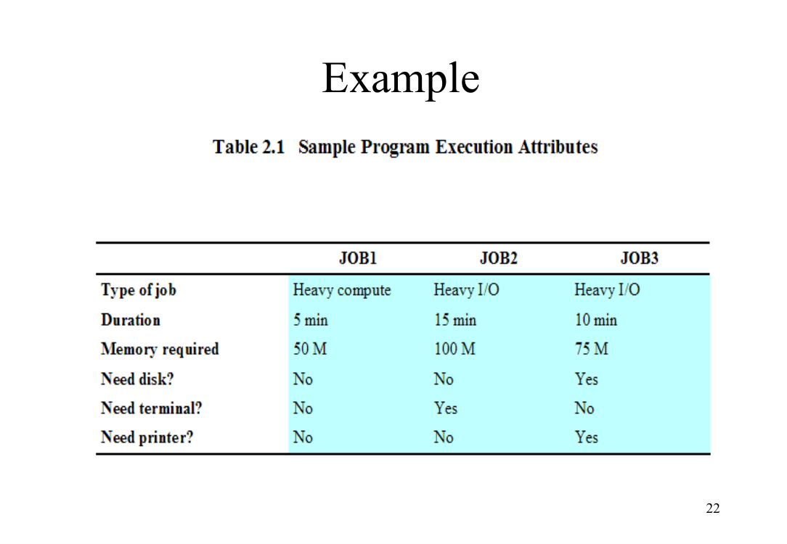

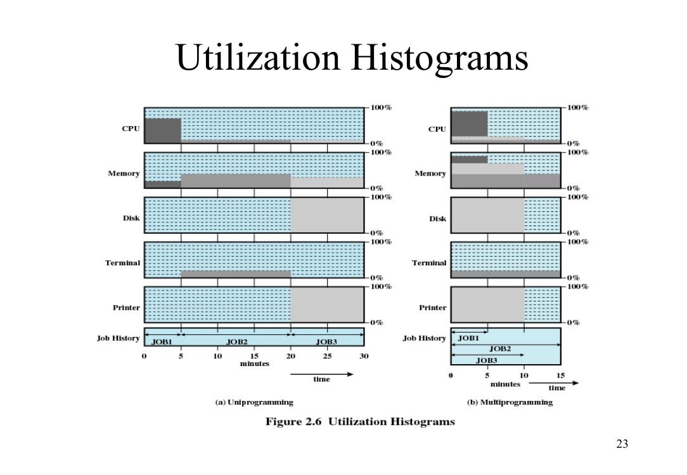

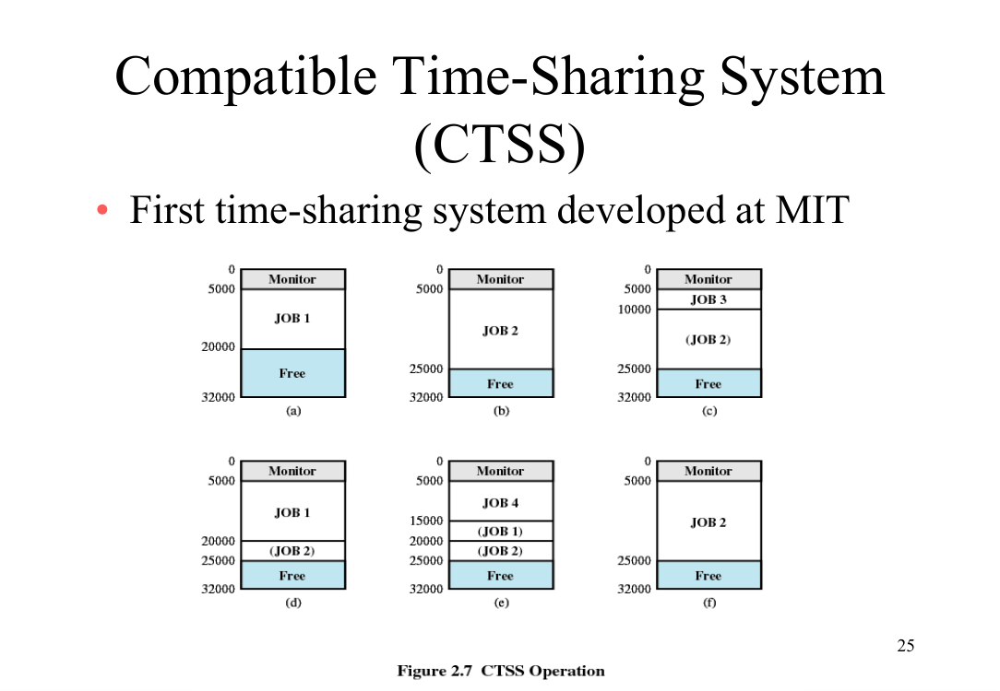

## Major achievements (five areas) (Slide 26)
Processes; memory management; information protection and security; scheduling and resource management; system structure.

### Processes (Slides 27-30)
- A process is: a program in execution; an instance of a program running on a computer; the entity that can be assigned to and executed on a processor; a unit of activity with a single sequential thread of execution, a current state, and a set of system resources.
- Difficulties in designing system software: improper synchronisation (a process waiting for I/O must get its signal), failed mutual exclusion, nondeterminate operation (a program should depend only on its input, not on other programs), deadlocks.
- A process has three components: an executable program, its associated data, and its **execution context** (everything the OS needs to manage the process). Slide 30 figure shows these as the process image, with the context holding state such as registers and priority.

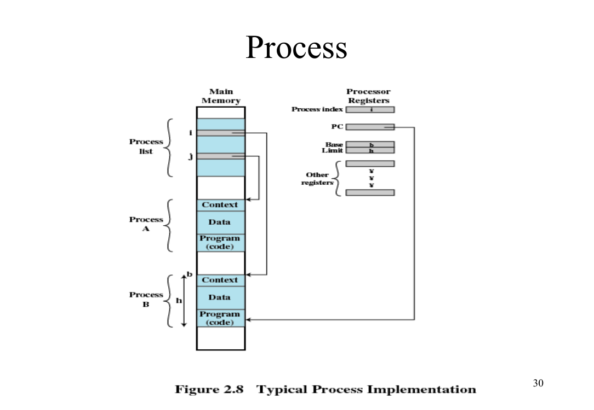

### Memory management (Slides 31-36)
- Responsibilities: process isolation, automatic allocation and management, support for modular programming, protection and access control, long-term storage.
- **File system**: implements long-term storage; information is kept in named objects called files.
- **Virtual memory**: lets programmers address memory logically, and avoids a gap between successive processes while one is swapped out and the next swapped in.
- **Paging**: a process consists of fixed-size blocks called pages; a virtual address is (page number, offset); each page can be anywhere in main memory; the real (physical) address is the location in main memory. Slides 35-36 figures show pages moving between main memory and disk, and the virtual-to-real address translation.

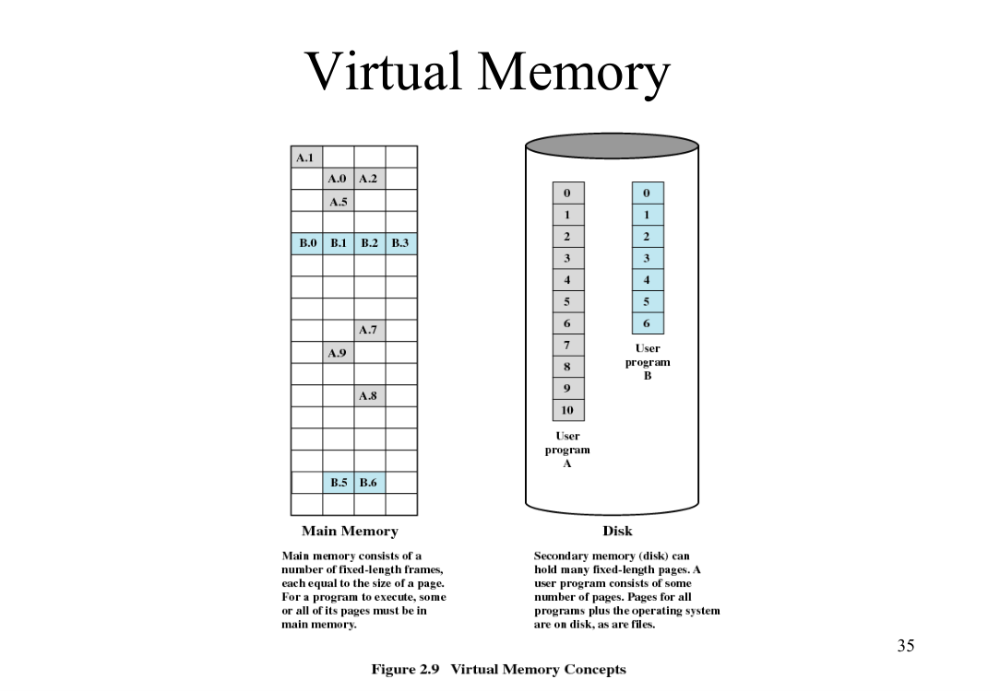

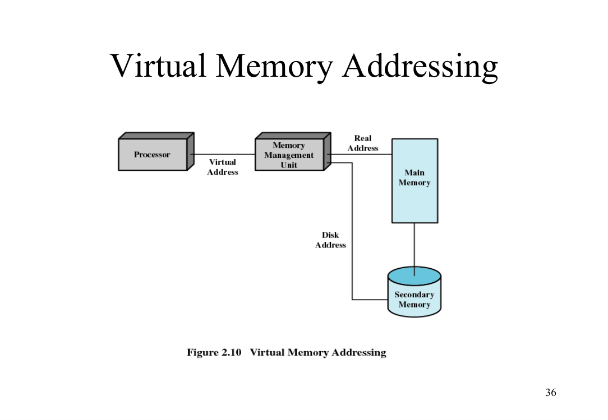

### Information protection and security (Slides 37-38)
- **Availability**: protect the system against interruption.
- **Confidentiality**: users cannot read data they are not authorised to read.
- **Data integrity**: protect data from unauthorised modification.
- **Authenticity**: proper verification of user identity and validity of messages or data.

### Scheduling and resource management (Slide 39)
- **Fairness**: equal and fair access to resources.
- **Differential responsiveness**: treat different classes of jobs differently.
- **Efficiency**: maximise throughput, minimise response time, accommodate as many users as possible.
- Slide 40 (Fig 2.11) shows the key elements of an OS for multiprogramming: a service call handler (service calls from processes), an interrupt handler (interrupts from processes and I/O), a short-term scheduler that passes control to a process, and queues (long-term, short-term, I/O).

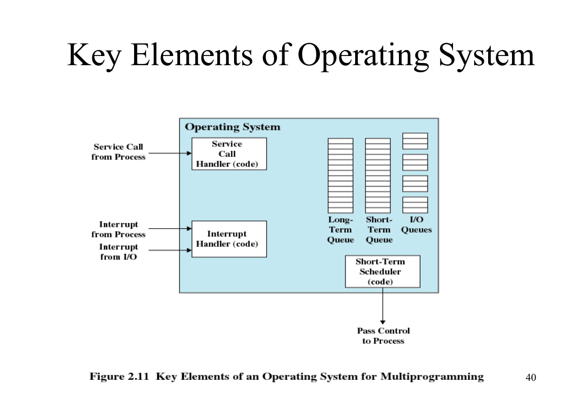

### System structure (Slides 41-42)
View the system as levels; each level performs a related subset of functions and relies on the level below for more primitive ones. This splits a problem into manageable subproblems. Slide 42 (Table 2.4) lists 13 levels: electronic circuits (1), instruction set (2), procedures (3), interrupts (4) (levels 1-4 are hardware), primitive processes (5), local secondary store (6), virtual memory (7), communications (8), file system (9), devices (10), directories (11), user processes (12) and the shell (13).

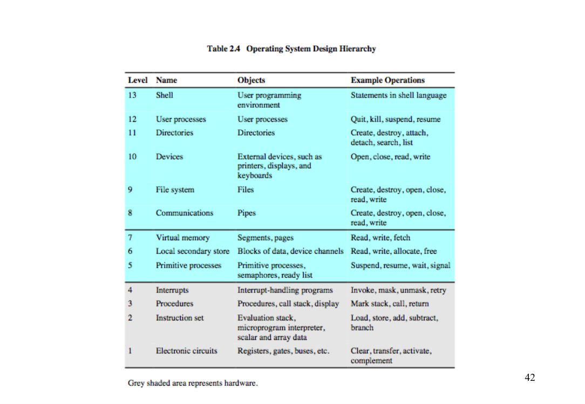

## Modern operating systems (Slides 43-48)
- **Microkernel**: only a few essential functions in the kernel (address spaces, interprocess communication, basic scheduling); everything else runs as server processes.
- **Multithreading**: a process is split into threads that run concurrently. A thread is a dispatchable unit of work that executes sequentially and can be interrupted; a process is a collection of one or more threads.
- **Symmetric multiprocessing (SMP)**: multiple processors share the same main memory and I/O facilities, and all can perform the same functions. Slide 46 compares multiprogramming (one processor interleaving processes) with multiprocessing (processes truly in parallel).
- **Distributed OS**: gives the illusion of a single main memory space and single secondary memory space across machines.
- **Object-oriented design**: adds modular extensions to a small kernel and lets programmers customise the OS without disrupting system integrity.

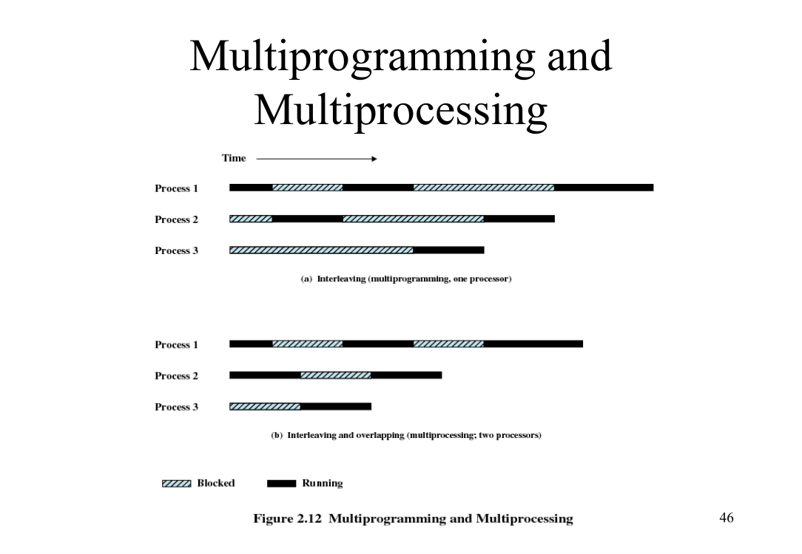

## Windows architecture (Slides 49-53)
- Goals: modular structure for flexibility, runs on varied hardware platforms, supports applications written for other OSes. Slide 50 figure: user-mode subsystems/services above kernel-mode components.
- Modified microkernel: not pure, since many system functions outside the microkernel run in kernel mode. Any module can be removed, upgraded or replaced without rewriting the system.
- Kernel-mode components:
  - **Executive**: base services (memory management, process and thread management, security, I/O, IPC).
  - **Kernel**: the most-used components.
  - **Hardware abstraction layer (HAL)**: isolates the OS from platform-specific hardware differences.
  - **Device drivers**: translate user I/O calls into hardware-specific requests.
  - **Windowing and graphics systems**: implement the GUI.

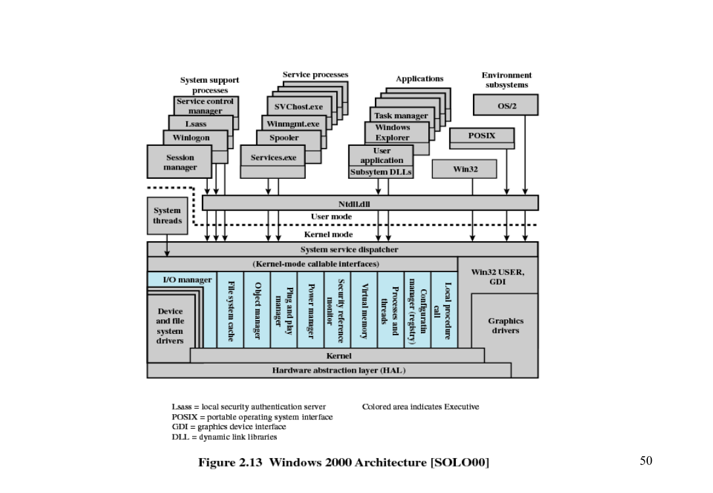

## UNIX (Slides 54-58)
- The hardware is surrounded by OS software, called the system kernel. User services and interfaces include the shell and components of the C compiler.
- Slide 55: layered view (hardware, kernel, system call interface, libraries, user programs/shell). Slide 56 (Fig 2.15): traditional kernel with a system call interface above the file subsystem (buffer cache, character and block device drivers) and the process control subsystem (IPC, scheduler, memory management), over hardware control. Slide 57 (Fig 2.16): modern kernel with a common facilities core and pluggable frameworks (exec switch, vnode/vfs interface, virtual memory framework, scheduler framework, block device switch, STREAMS).
- Modern UNIX systems: System V Release 4 (SVR4), Solaris 9, 4.4BSD, Linux.

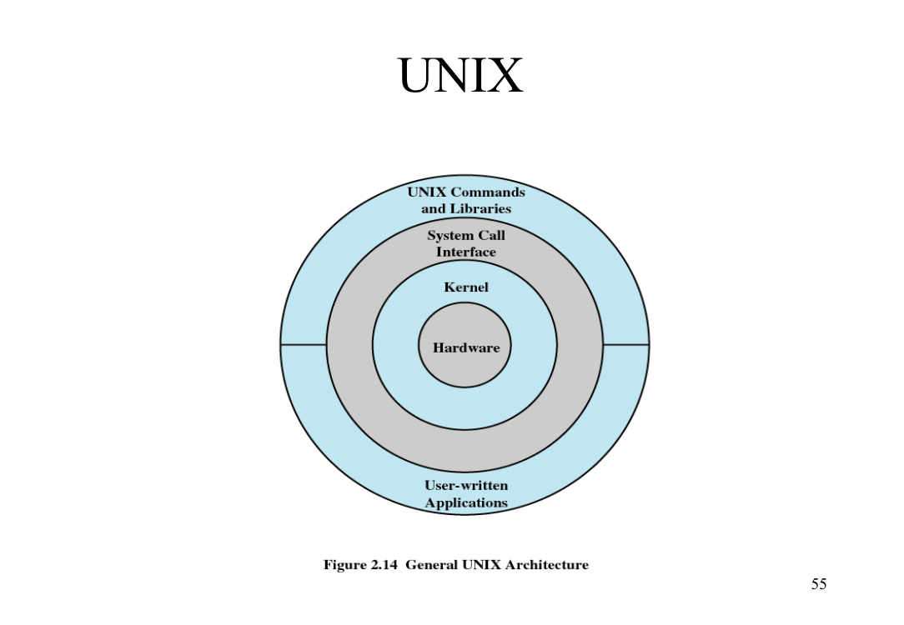

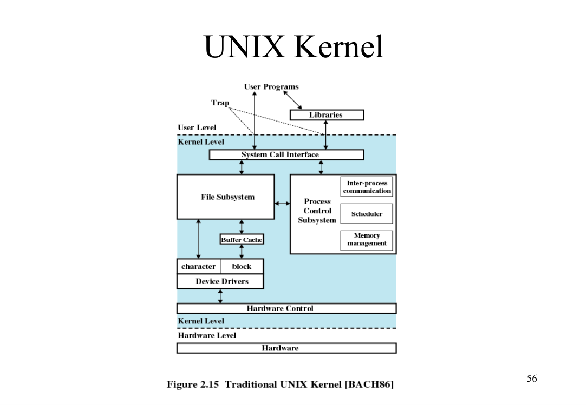

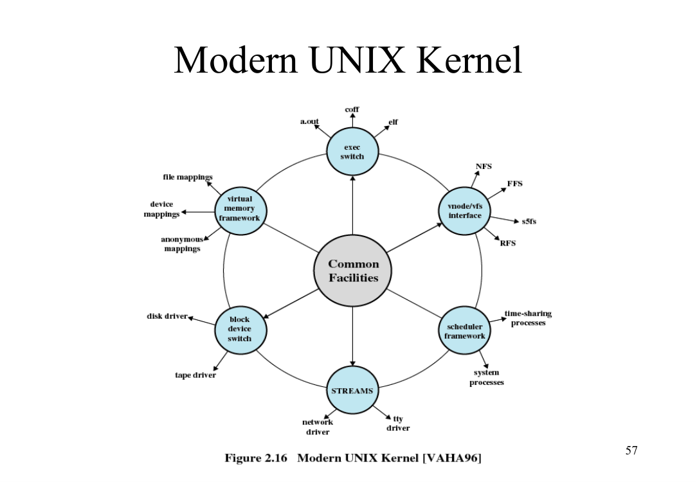

## Key terms
kernel/nucleus, monitor, batch, serial processing, uniprogramming, multiprogramming, time sharing, CTSS, user mode, kernel mode, privileged instruction, process, execution context, virtual memory, paging, virtual/real address, microkernel, thread, multithreading, SMP, distributed OS, executive, HAL.

## Questions
[Practice questions](../questions/topic-02-questions.md)

## Sources
- Slides: ICT374Topic02.pdf, slides 1-58 (figure slides 6, 11, 18-23, 25, 30, 35-36, 40, 42, 46, 50, 55-57 were checked against rendered slide images).
- Stallings, Operating Systems, Ch 2 (2.1-2.4, 2.7-2.9), printed pp. 69-94, 101-112; Tables 2.1/2.2 and Figs 2.4-2.6, pp. 77-80.
