# Topic 03: Process Description and Control

## Overview
This lecture defines what a process is, how the OS models its life cycle (process states), how the OS describes it (control tables, process image, process control block), and how it is created, switched and terminated. It ends with how UNIX SVR4 does this. Key distinctions: process vs program, mode switch vs process switch, and the state models.

## Process (slide 4)
- A program in execution; an instance of a program running on a computer.
- The entity that can be assigned to and executed on a processor.
- A unit of activity characterised by a sequence of instructions, a current state and an associated set of system resources.

## Process elements and the Process Control Block (slides 5-7)
Elements: identifier, state, priority, program counter, memory pointers, context data, I/O status information, accounting information.
The **process control block (PCB)** holds these elements. It is created and managed by the OS and is what allows support for multiple processes (the OS can interrupt a process and later resume it from the saved PCB data).

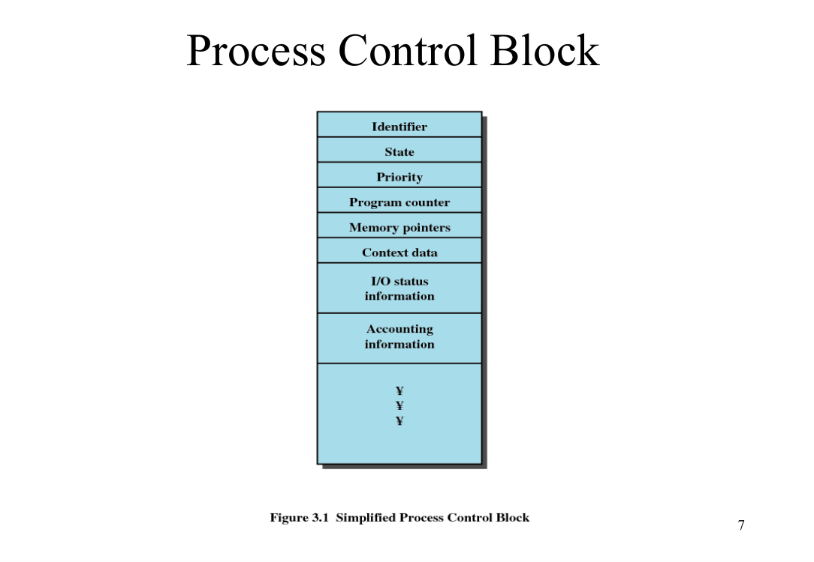

## Trace of a process (slides 8-11)
- A **trace** is the sequence of instructions that executes for a process.
- The **dispatcher** is a small program that switches the processor from one process to another.
- Slides 9-11 (Figs 3.2-3.4) show three example processes in memory at 5000 (A, 12 instructions), 8000 (B, 4) and 12000 (C, 12), with the dispatcher at 100. The snapshot is at instruction cycle 13 (PC = 8000). Their traces are interleaved with dispatcher instructions (100-105), with a time-out after every 6 instructions and an I/O request in B; Figure 3.7 (slide 21) shows the resulting timeline: each process is Running, Ready or Blocked, and the dispatcher runs between process slices.

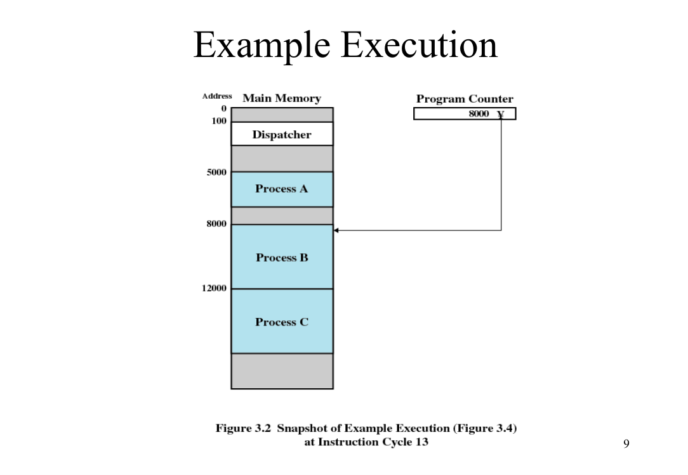

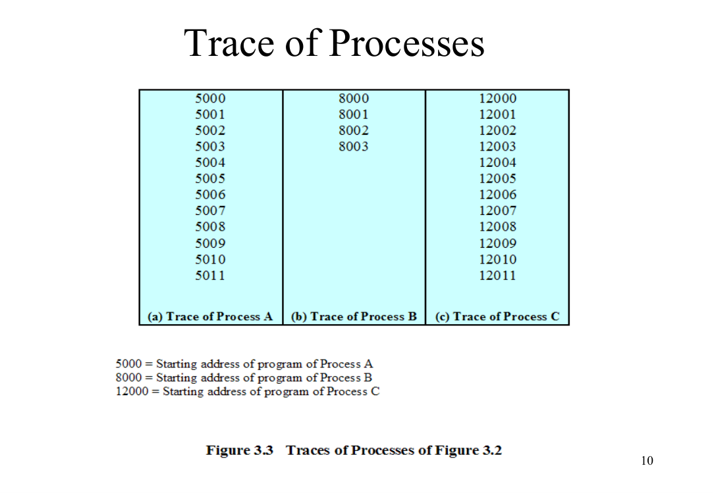

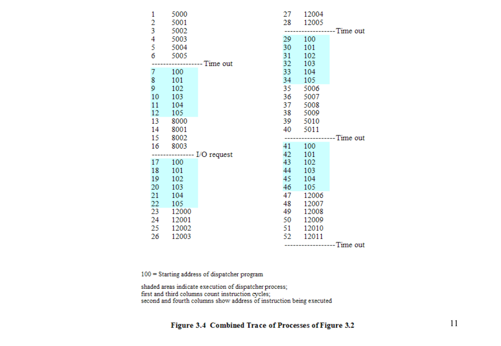

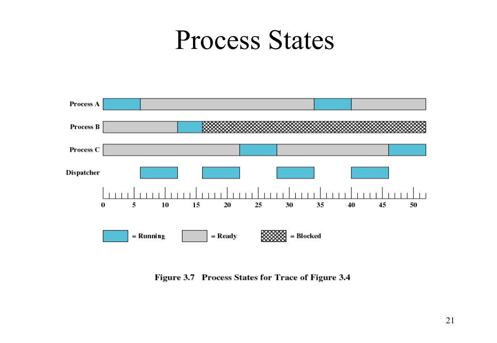

## Two-state process model (slides 12-13)
- States: **Running** and **Not-running**.
- Not-running processes wait in a queue; the dispatcher picks the next one. A running process that is interrupted goes back to the queue; a finished process leaves the system.

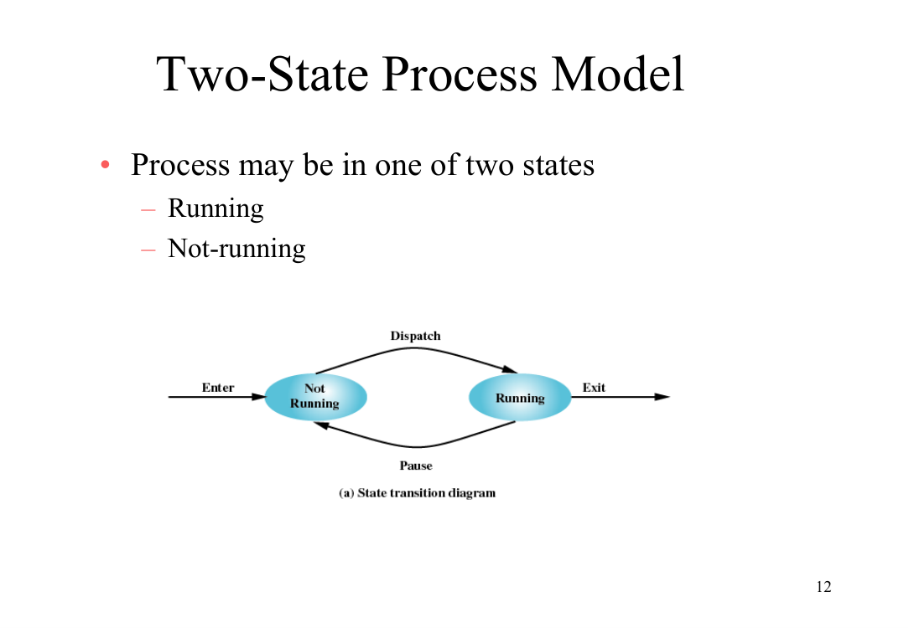

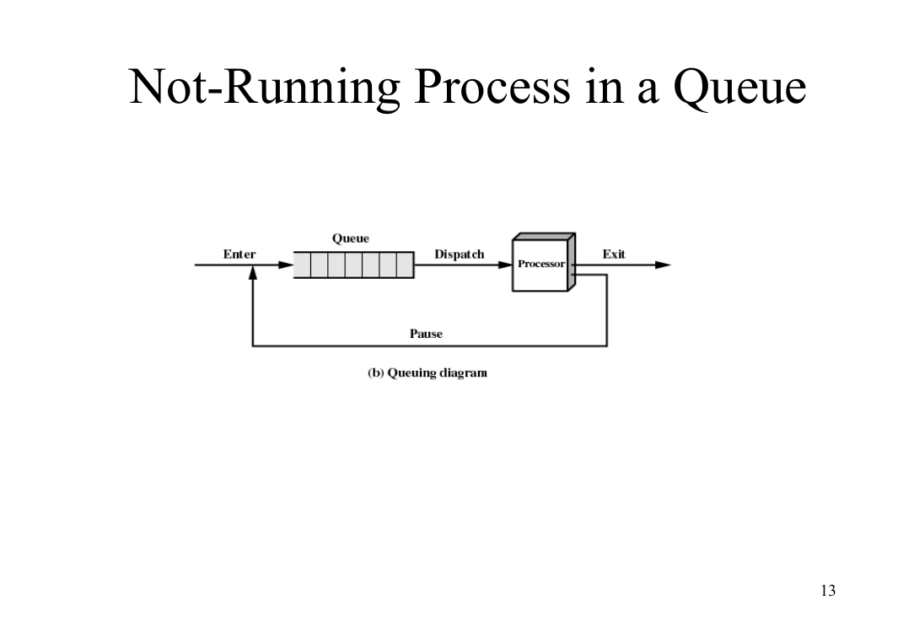

### Process creation (slide 14)
Reasons: new batch job; interactive logon; created by the OS to provide a service (e.g. printing, without making the user wait); **spawned** by an existing process (modularity or parallelism). The creating process is the parent, the new one the child.

### Process termination (slides 15-16)
Table 3.2 reasons: normal completion, time limit exceeded, memory unavailable, bounds violation, protection error, arithmetic error (slide 15); time overrun, I/O failure, invalid instruction, privileged instruction, data misuse, operator or OS intervention, parent termination, parent request (slide 16).

### Problem with the two-state model (slide 17)
Not-running mixes "ready to execute" and "blocked (waiting for I/O)". The dispatcher cannot simply take the longest-waiting process because it may be blocked.

## Five-state model (slides 18-22)
States: **New, Ready, Running, Blocked, Exit**.
- Admit: New to Ready. Dispatch: Ready to Running. Timeout: Running to Ready. Event wait: Running to Blocked. Event occurs: Blocked to Ready. Release: Running to Exit.
- Using two queues (slide 20): a ready queue and a blocked queue; when an event occurs the OS moves the process from blocked to ready.
- Multiple blocked queues (slide 22): one queue per event, so the OS does not have to scan all blocked processes when an event occurs.
- Slide 21 (Figure 3.7) shows the state of A, B, C over time.

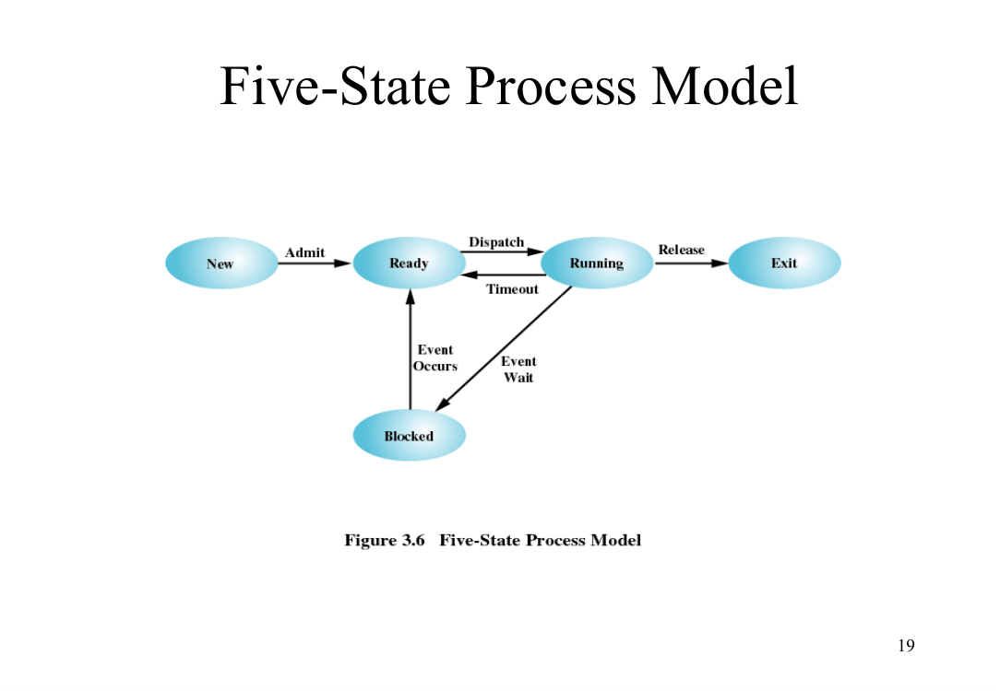

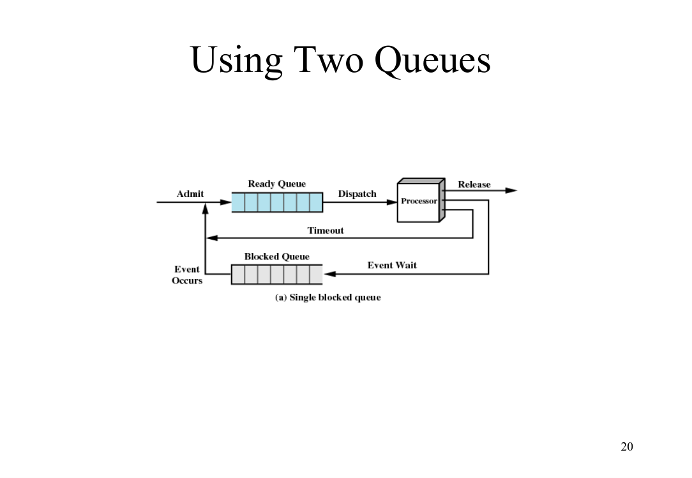

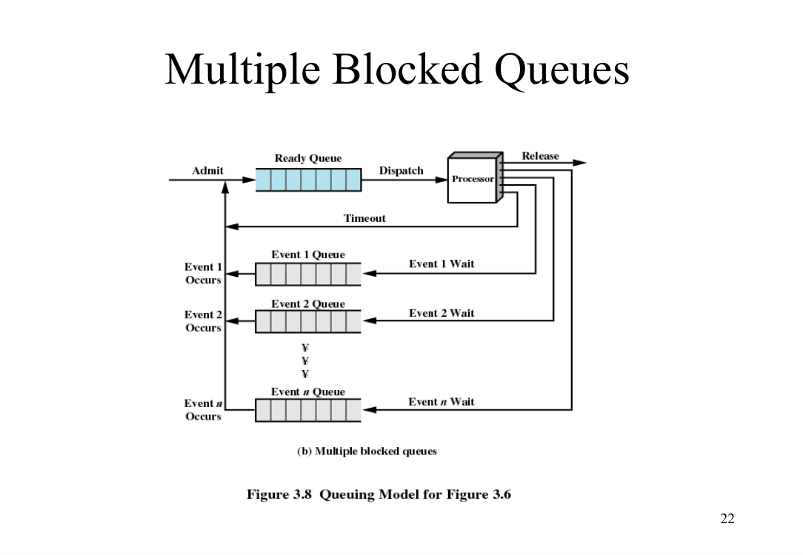

## Suspended processes (slides 23-26)
- The processor is faster than I/O, so all processes could be waiting for I/O. **Swap** these processes to disk to free memory.
- A blocked process that is swapped to disk is in the **suspend** state. With one suspend state (slide 24): Blocked to Suspend ("suspend"), Suspend to Ready ("activate").
- With **two suspend states** (slide 25, Figure 3.9b): **Blocked/Suspend** and **Ready/Suspend**. Transitions: Suspend (Ready to Ready/Suspend, Blocked to Blocked/Suspend, Running to Ready/Suspend), Activate (back to Ready/Blocked), Event occurs (Blocked/Suspend to Ready/Suspend), and Admit can go from New to Ready or Ready/Suspend.
- Reasons for suspension (Table 3.3, slide 26): swapping, other OS reason, interactive user request, timing, parent process request.

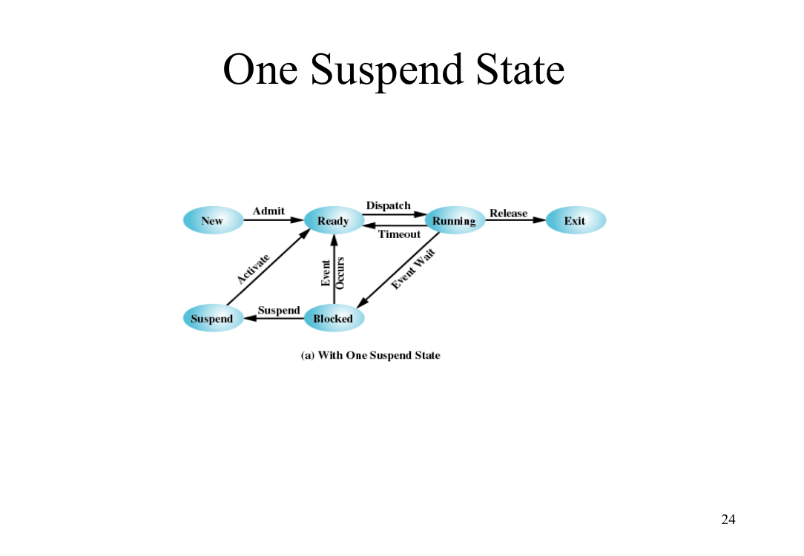

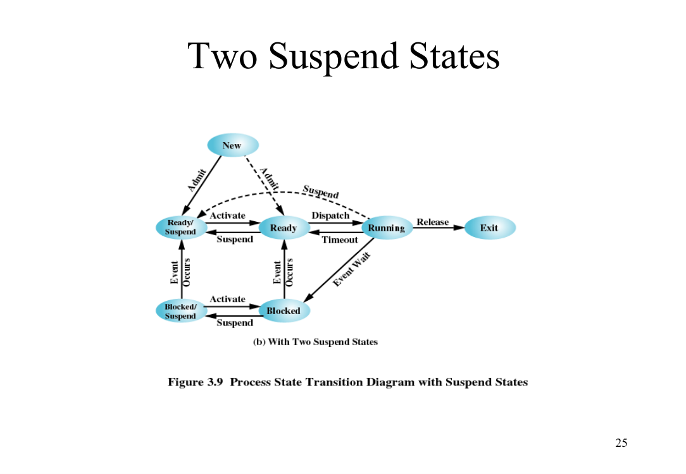

## Operating system control structures (slides 27-33)
The OS keeps tables for every entity it manages (Figure 3.11, slide 29): **memory tables** (main/secondary memory allocation, protection attributes for shared regions, virtual memory info), **I/O tables** (device available/assigned, status of I/O operation, memory location used for the transfer), **file tables** (existence, location on secondary storage, status, attributes; sometimes kept by the file system), and the **process table**. Slide 28 (Fig 3.10) shows processes P1..Pn using computer resources (processor, I/O devices, main memory) in a snapshot. The primary process table has one entry per process, pointing to its process image: where the process is (program, data, stack) plus attributes in the PCB (identification, processor state, process control).

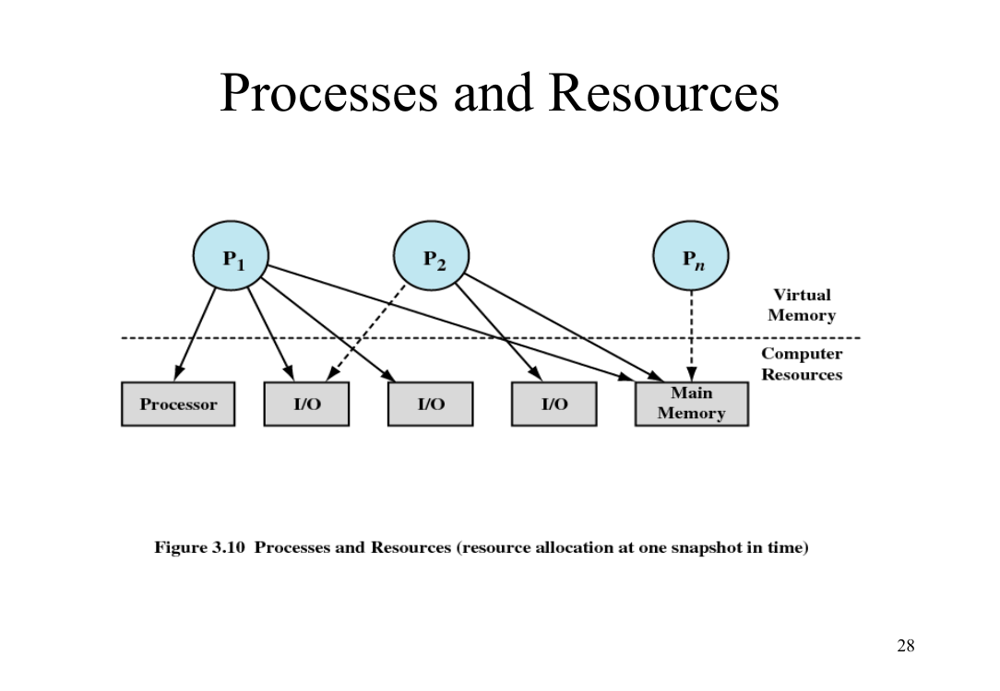

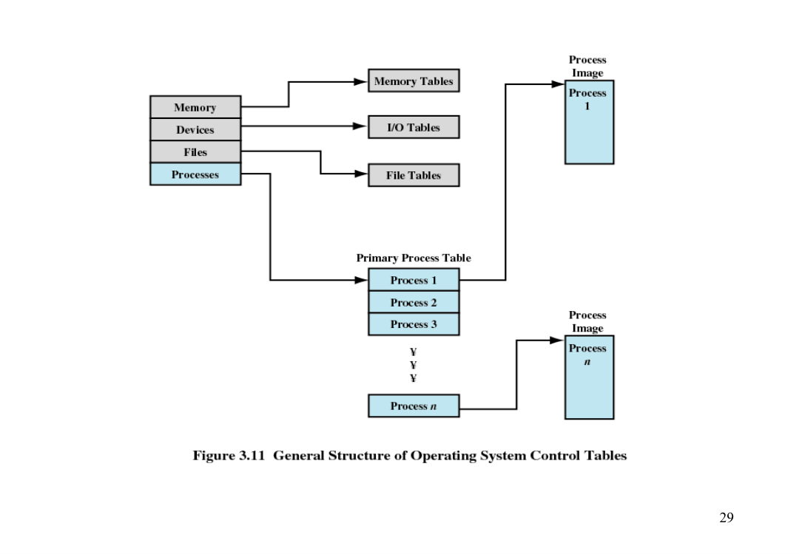

## Process image (slide 34)
Process image = program (code), data, stack, and the PCB. Slide 51 (Fig 3.16) shows the layout: PCB (process identification, processor state information, process control information), user stack, private user address space (programs, data), kernel stack, optional shared address space.

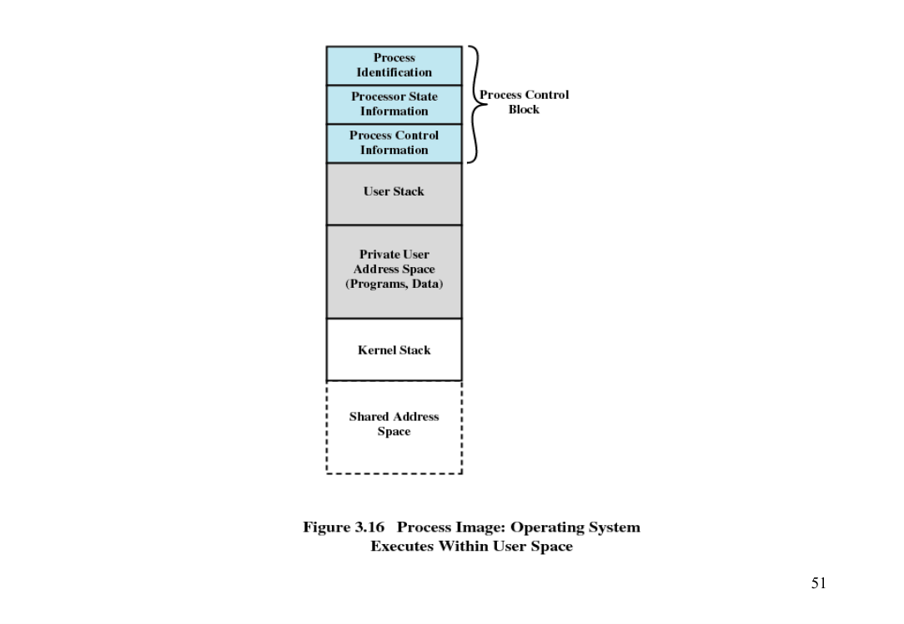

## PCB contents (slides 35-41)
1. **Process identification**: process ID, parent process ID, user ID.
2. **Processor state information**: user-visible registers, control and status registers (PC, **program status word (PSW)**, e.g. the EFLAGS register on Pentium, slide 37), stack pointers.
3. **Process control information**:
   - Scheduling and state information: state, priority, scheduling-related info (waiting time, last run time), event awaited (scheduling is Topic 10).
   - Interprocess communication: flags, signals, messages (Topic 7).
   - Process privileges: memory that may be accessed, instructions that may be executed, system utilities/services.
   - Memory management: pointers to segment/page tables (Topic 9).
   - Resource ownership and utilization: open files, resource usage history.
   - Data structuring: links to other processes (queue, ring, parent-child).

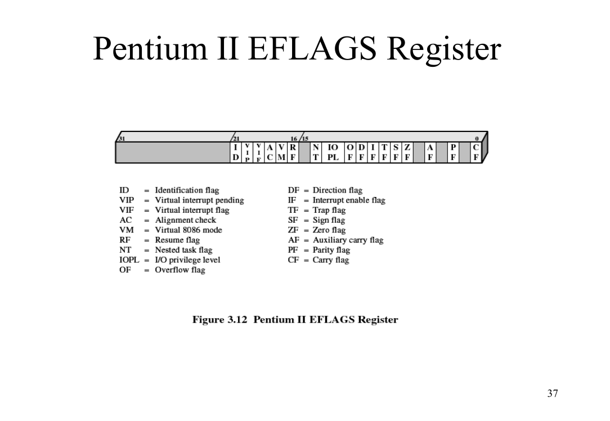

## Modes of execution (slide 42)
- **User mode**: less privileged; user programs run here.
- **System/control/kernel mode**: more privileged; the OS kernel. Two modes protect the OS and its tables from user programs.

## Process creation steps (slide 43)
Assign a unique process identifier; allocate space for the process; initialise the PCB; set up linkages (e.g. add to the scheduling queue linked list); create or expand other data structures (e.g. accounting file).

## When to switch a process (slides 44-45)
Clock interrupt (time slice used up), I/O interrupt, memory fault (e.g. page fault: address is in virtual memory and must be brought into main memory), trap (error or exception, may move the process to Exit), supervisor call (e.g. file open).

## Switching a process (slides 46-47)
1. Save the processor context (PC and other registers).
2. Update the PCB of the running process.
3. Move its PCB to the appropriate queue (ready, blocked, ready/suspend).
4. Select another process.
5. Update the PCB of the selected process.
6. Update memory-management structures such as the page table (very expensive).
7. Restore the context of the selected process.

**Mode switch vs process switch**: a mode switch (e.g. an interrupt entering the kernel) changes only the processor mode and need not change which process is running; a process switch changes the running process and needs the full save/restore above, so it is far more costly.

## Execution of the OS (slides 48-51)
Figure 3.15 (slide 50):
- **Non-process kernel**: the kernel runs outside any process, in privileged mode, as a separate entity.
- **Execution within user processes**: OS code runs in the context of a user process in privileged mode; only the process-switching functions are separate.
- **Process-based OS**: the OS is a collection of system processes; useful in multiprocessor or multicomputer environments.

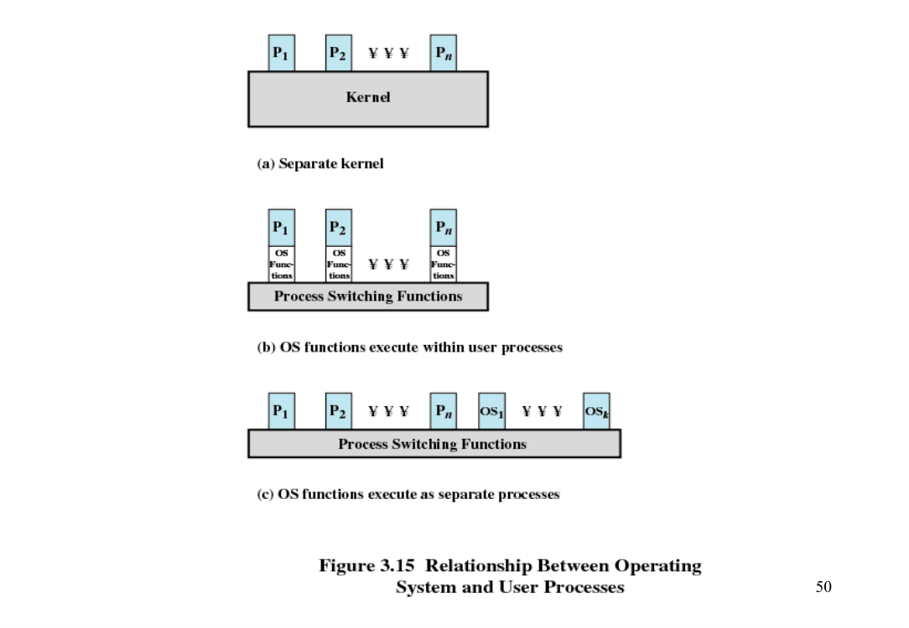

## UNIX SVR4 process management (slides 52-55)
- Most of the OS executes within the environment of a user process.
- **Process states (Table 3.9, slide 53)**: User Running, Kernel Running, Ready to Run in Memory, Asleep in Memory (blocked), Ready to Run Swapped, Sleeping Swapped, Preempted (returning from kernel to user mode, but the kernel does a process switch), Created, Zombie (process no longer exists but leaves a record for its parent to collect).
- **Process image (Table 3.10, slide 54)**: user-level context (process text, data, user stack, shared memory); register context (program counter, processor status register, stack pointer, general-purpose registers); system-level context (process table entry, U (user) area, per-process region table, kernel stack).
- **State diagram (Figure 3.17, slide 55)**: `fork` creates a process in Created, which goes to Ready to Run in Memory (enough memory) or Ready to Run Swapped. Ready to Run in Memory goes to Kernel Running on "reschedule process" (a dashed arrow links Preempted to it). Kernel Running goes to User Running on return, to Zombie on exit, to Asleep in Memory on sleep, to Preempted on preempt. System calls and interrupts take User Running to Kernel Running; interrupts also nest within Kernel Running. Swap in/out and wakeup link the in-memory and swapped states.
- `fork()` creates a new (child) process: returns 0 in the child and the child's PID in the parent. The slides only name process system calls via the objectives and the `fork` arrow in Figure 3.17.

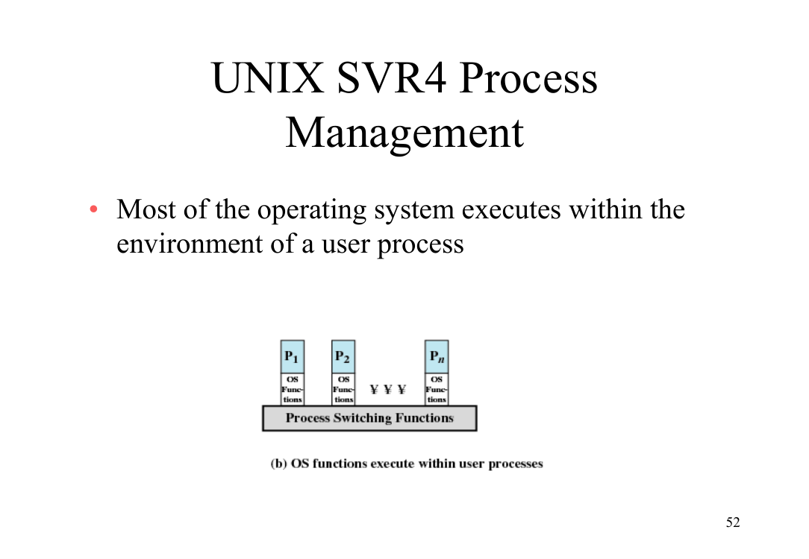

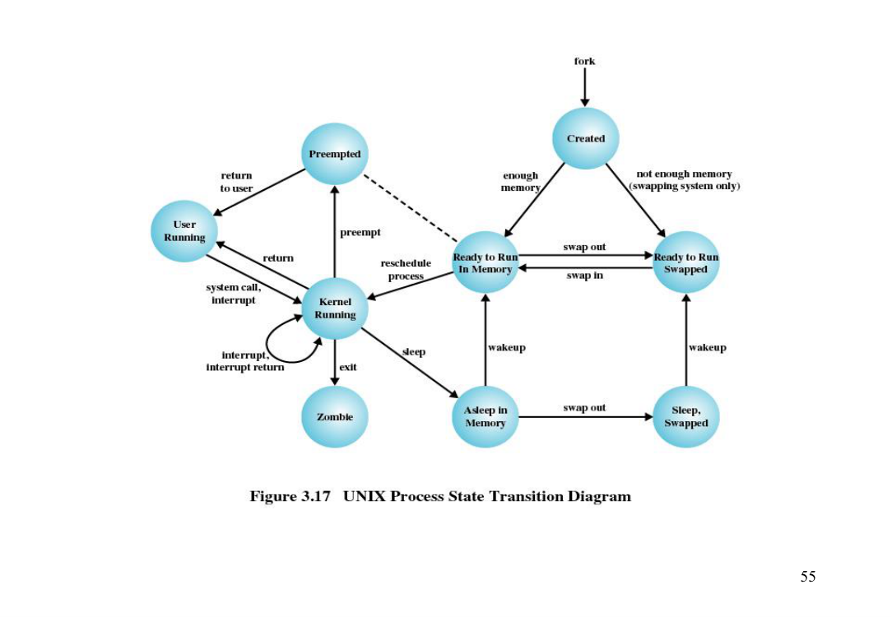

## Key terms
process, trace, dispatcher, PCB, process image, process table, running/ready/blocked/new/exit, suspend, swapping, preempt, time slice, user mode, kernel mode, mode switch, process switch, PSW, interrupt, trap, supervisor call, spawn, parent/child, zombie.

## Questions
[Practice questions](../questions/topic-03-questions.md)

## Sources
- Lecture slides: ICT374Topic03, slides 1-55 (figure slides 7, 9-13, 15-16, 19-22, 24-26, 28-29, 34, 37, 50-55 were checked against rendered slide images).
- Stallings Ch 3: 3.1 What is a process (p. 131), 3.2 Process states (p. 133), 3.3 Process description (p. 148), 3.4 Process control (p. 157), 3.5 Execution of the OS (p. 163), 3.6 UNIX SVR4 process management (pp. 166-170).
