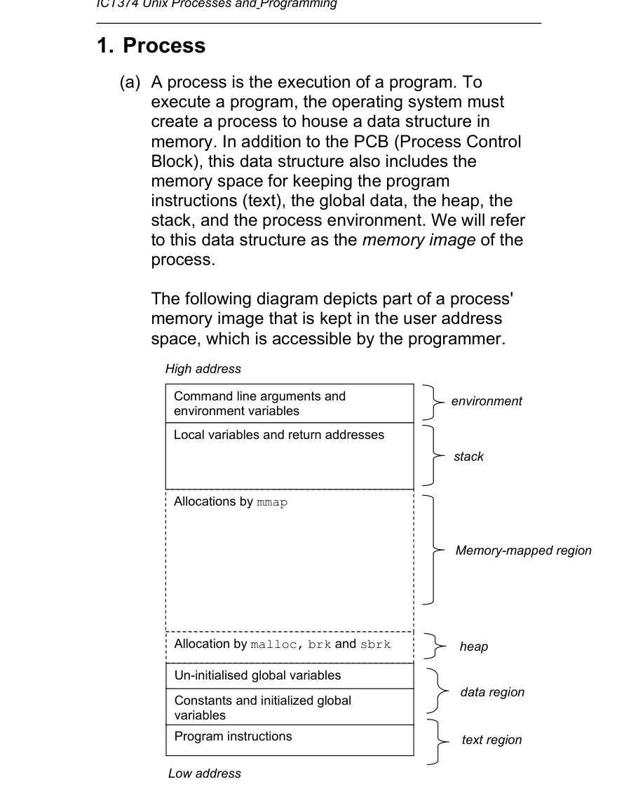
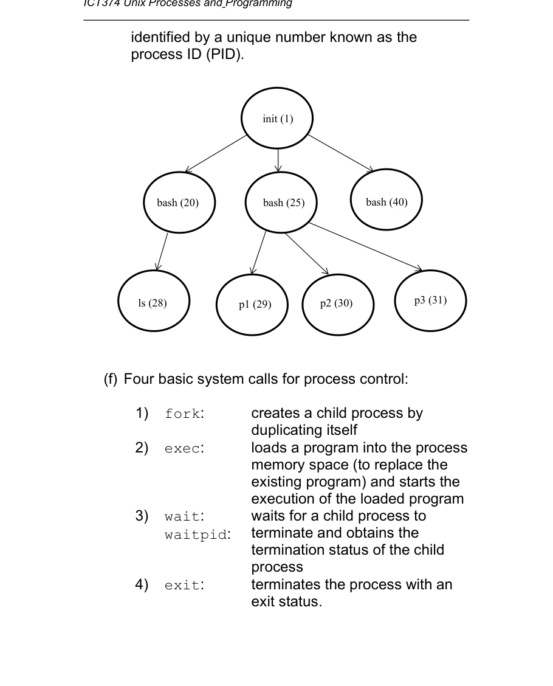
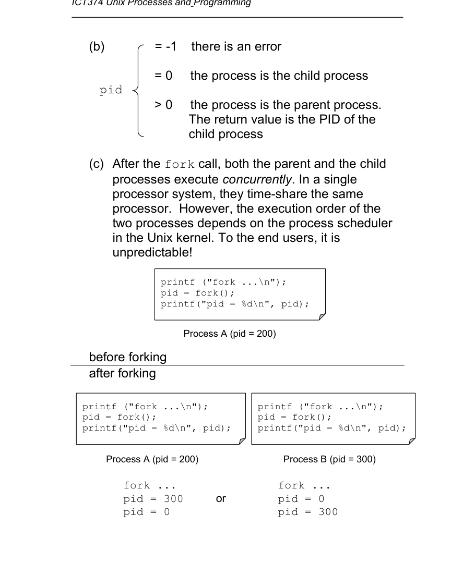
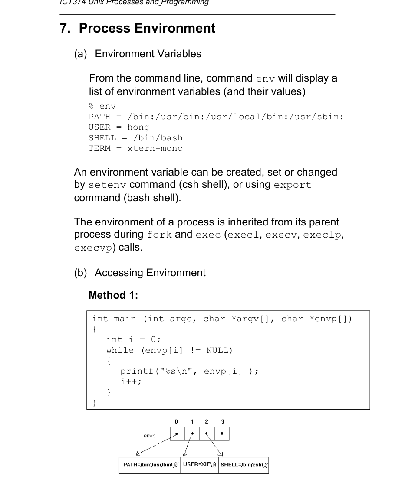
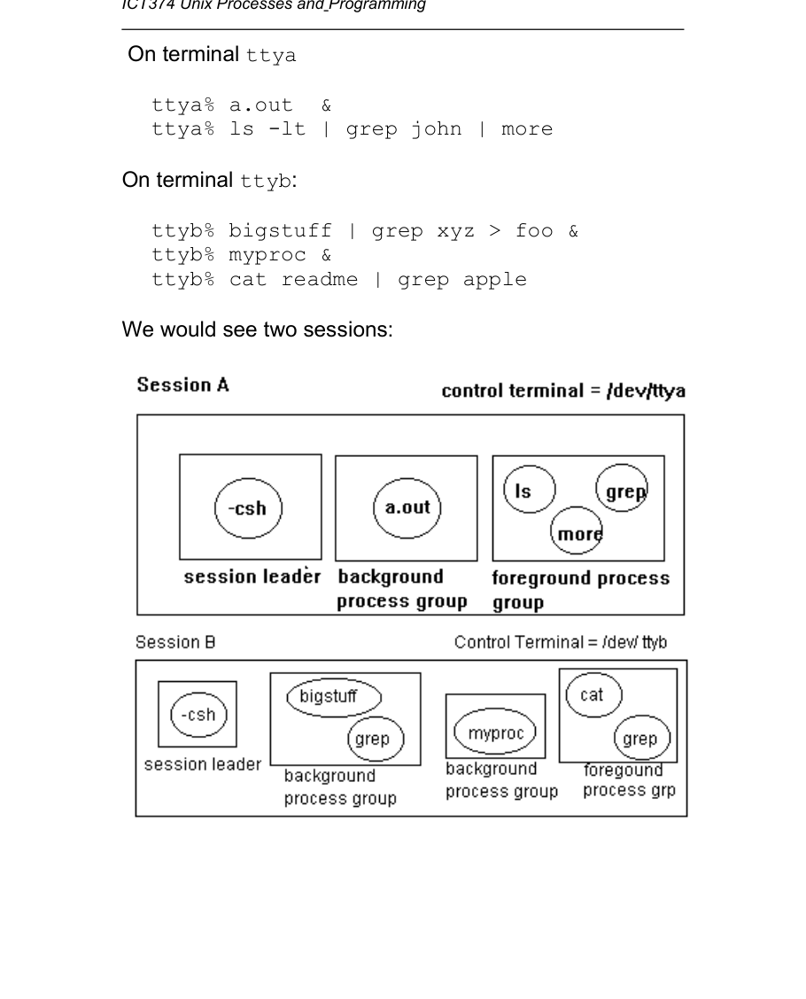

# Topic 04: Unix Processes and Programming

## Overview
A process is a running program. This topic covers what a process contains, how to create one (`fork`), replace its program (`exec`), end it (`exit`), wait for it (`wait`/`waitpid`), read and pass its environment, group processes into process groups and sessions, and turn a process into a daemon.

## 1. Process (slides 2-4)
- A **process** is the execution of a program. The OS builds a **memory image**: the PCB plus text (instructions), global data, heap, stack and environment.
- User address space, high to low address: command-line args and environment variables; stack (locals, return addresses); memory-mapped region (mmap); heap (malloc, brk, sbrk); data region (uninitialised globals, then constants and initialised globals); text region (program instructions).
- Many processes run concurrently; several can come from one program. On a single CPU they time-share it.
- A process is also defined by changing data: global values, heap, stack, environment, CPU registers, PCB state, I/O status, open files. Instructions do not change.
- Each process has its own address space. Processes communicate through IPC: pipes, FIFOs, files, sockets, shared memory, message queues.
- A parent creates a child; each process has a unique **PID**. Processes form a tree rooted at `init` (PID 1), e.g. shells (`bash`) as children of init and commands (`ls`, `p1`) as children of shells.
- Four basic process-control calls:
  - `fork`: create a child by duplicating the caller.
  - `exec`: load a new program into the process's memory, replacing the old one, and start it.
  - `wait`/`waitpid`: wait for a child to terminate and get its termination status.
  - `exit`: terminate the process with an exit status.

## 2. The fork call (slides 5-7)
- `pid_t pid = fork();` (`<unistd.h>`) duplicates the calling process. Immediately afterwards the child's text, data, heap, stack and environment equal the parent's, except for fork's return value.
- Return value: `-1` error; `0` you are the child; `>0` you are the parent and the value is the child's PID.
- Both processes then run concurrently. Which runs first is up to the kernel scheduler, so output order is unpredictable (slide 6: A prints `pid = 300`, B prints `pid = 0`, in either order).
- Typical pattern (`spawn.c`): test `pid==0` / `pid>0` / else (error).

## 3. The exec family (slides 8-11)
- Six functions that all end up in the system call `execve`. The existing text, data, stack and heap are completely replaced; execution starts at the new program's `main`. No new process is created, so PID (and usually other attributes) stay the same.
- Prototypes: `execl(path, arg0, ..., (char*)0)`, `execv(path, argv[])`, `execlp(file, arg0, ...)`, `execvp(file, argv[])`, `execle(path, arg0, ..., (char*)0, envp[])`, `execve(path, argv[], envp[])`.
- They differ in three ways:
  - **Locating the file:** `execl`, `execv` use the given pathname; `execlp`, `execvp` search the directories in `PATH`. (The slide says `execle`/`execve` use the `PATH` in `envp`; their first argument is a pathname.)
  - **Passing arguments:** `l` variants take a list of strings ending in `(char *)0`; `v` variants take an array of strings (last element `(char *)0`).
  - **Environment:** only `execle` and `execve` replace the environment, using the `envp` array (strings like `PATH=/usr/bin:/bin`); the other four keep the current one.
- Example: `execl("/bin/ls", "ls", "-lt", (char *)0)` equals `execlp("ls", "ls", "-lt", (char *)0)`.
- A successful exec does not return. It returns -1 only on failure, so code after it (e.g. `printf("execl failed...")`, `exit(1)`) runs only if exec failed.
- Environment inheritance: set up in shell init files (`.bashrc`, `.bash_profile`, `.profile`, `.login`, `.cshrc`). The shell passes it to new processes; `fork` copies the parent's environment to the child.

## 4. The exit function (slide 12)
- `void exit(int exitstatus)` (`<stdlib.h>`, ANSI C) calls the POSIX system call `_exit` to (1) clean up (close open file descriptors) and free memory, (2) terminate the process and give its parent an exit status.
- `return` vs `exit`: in `main` both end the process; in any other function `return` goes back to the caller, while `exit` ends the whole process.

## 5. wait and waitpid (slides 13-16)
- `pid_t wait(int *statloc)`: blocks until one child terminates; returns that child's PID (or -1) and stores the termination status in `*statloc`. Pass `NULL` / `(int *)0` if the status is not needed.
- Status is one integer holding either the termination signal number (child killed by a signal) or the exit status (child called `exit`). Bit layout varies by OS.
- Special cases of `wait`:
  - No children, or all already claimed: returns -1 immediately.
  - A child already exited but not yet waited for (a **zombie**): returns immediately with its PID and status.
  - If the parent dies first, `init` adopts the child and claims it when it ends.
- `pid_t waitpid(pid_t pid, int *statloc, int option)`: added because `wait` cannot choose a child and always blocks.
  - `pid == -1` any child; `pid > 0` that child; `pid == 0` any child in the caller's process group; `pid < -1` any child whose group ID is `|pid|`.
  - `options == 0` blocking; `WNOHANG` non-blocking.
- Status macros: `WIFEXITED(s)` (normal exit), `WEXITSTATUS(s)` (the exit status), `WIFSIGNALED(s)` (killed by signal), `WTERMSIG(s)` (the signal number). See `man -S 2 wait`. Signals come in Topic 6.

## 6. Process synchronisation (slide 17)
Example `runls`: `fork`; the parent calls `wait` then prints "ls completed"; the child calls `execl("/bin/ls", "ls", "-l", (char*)0)` and, if that returns, `perror` and `exit(1)`; `pid < 0` means fork failed.

## 7. Process environment (slides 18-19)
- `env` lists environment variables; `export` (bash) or `setenv` (csh) sets them. A process inherits its environment through `fork` and the non-`e` exec calls.
- Access method 1: third argument of main, `int main(int argc, char *argv[], char *envp[])`, a NULL-terminated array of strings.
- Access method 2 (POSIX.1): `extern char **environ;`, same structure.
- `char *getenv(const char *name)` returns the value of a variable or NULL, e.g. `getenv("USER")`.

## 8. Process groups and sessions (slides 20-21)
- Besides parent/child, each process belongs to one **process group**, and each group belongs to one **session**.
- A **session** is a collection of process groups, usually tied to one control terminal. Groups created in a terminal login (local, SSH, TELNET) share a session unless a process creates a new one.
- A **process group** is a collection of processes; a process inherits its group (and session) from its parent unless it makes a new group or is placed in another. With job control, all processes of one job are in one group, e.g. `ls -lt | grep john | more`.
- Slide 21 example: login on `ttya` runs `a.out &` and `ls -lt | grep john | more`; login on `ttyb` runs `bigstuff | grep xyz > foo &`, `myproc &`, `cat readme | grep apple`. This gives two sessions, one per terminal, with a process group per job.

## 9. Process group calls (slide 22)
- Each group has a unique process group ID; the leader's group ID equals its own PID.
- `int setpgid(pid_t pid, pid_t pgid)`: move process `pid` into group `pgid`; returns 0 or -1. A process may move only itself (`pid=0`) or one of its children. `pgid=0` means use `pid` as the group ID. `setpgid(0,0)` creates a new group with the caller as leader.

## 10. Daemon processes (slides 23-27)
A **daemon** usually has no controlling terminal and runs until explicitly stopped (e.g. web or SSH server). To make one:
- **(a) Survive logout:** the shell kills its children at logout, so the daemon must not be killed with its session.
- **(b) No controlling terminal:** otherwise keystrokes like Ctrl-C and Ctrl-\ affect it. Move it to a new session with no terminal.
- **(c) Sensible current directory:** it inherits the shell's directory, which may be arbitrary; use one suited to the service (e.g. web document root).
- **(d) Allow file systems to be unmounted:** a process whose current directory is on a file system blocks unmounting it. The root file system is never unmounted. Check mounts with `df -a` or `mount`.
- `daemon_init()` (slide 26):
  1. `fork`; the parent prints the child's PID and `exit(0)`, so the shell gets control back.
  2. Child calls `setsid()`: creates a new session (it becomes session leader) with no controlling terminal.
  3. `chdir("/")`: current directory on the root file system.
  4. `umask(0)`: clear the file creation mask so files get exactly the permissions requested (Topic 5).
- A daemon cannot use `printf` to the screen (no terminal), so it writes messages to a **log file**. The log file is left to the application, not `daemon_init`.
- `useless.c` (slide 27): open `/tmp/useless.log`, call `daemon_init()`, log its PID, then loop forever: `sleep(100)` and write "Who says that I am useless?", with `fflush` after each write.

## Key terms
process, memory image, PCB, PID, parent/child, init, fork, exec family, execve, exit/_exit, wait, waitpid, WNOHANG, zombie, adopted by init, termination status, WIFEXITED, WEXITSTATUS, WIFSIGNALED, WTERMSIG, environment, envp, environ, getenv, process group, group leader, setpgid, session, setsid, control terminal, daemon, umask, chdir, log file, root file system.

## Questions
[Practice questions](../questions/topic-04-questions.md)

## Sources
- Lecture slides ICT374Topic04.pdf, slides 1-27 (Page n of 27).
- APUE (Stevens and Rago) Ch 7.1-7.9, Ch 8, Ch 13 (reading list). Core pages: pp. 197-206, 210-212, 227-255, 293-306, 463-478. Used only as background; the notes follow the slides.
