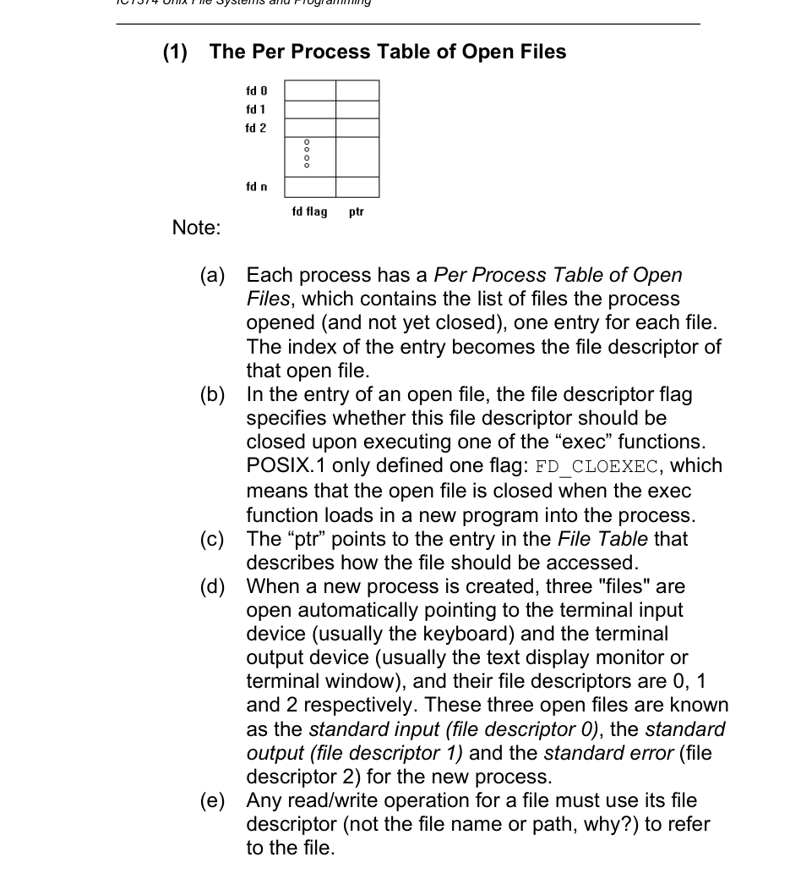
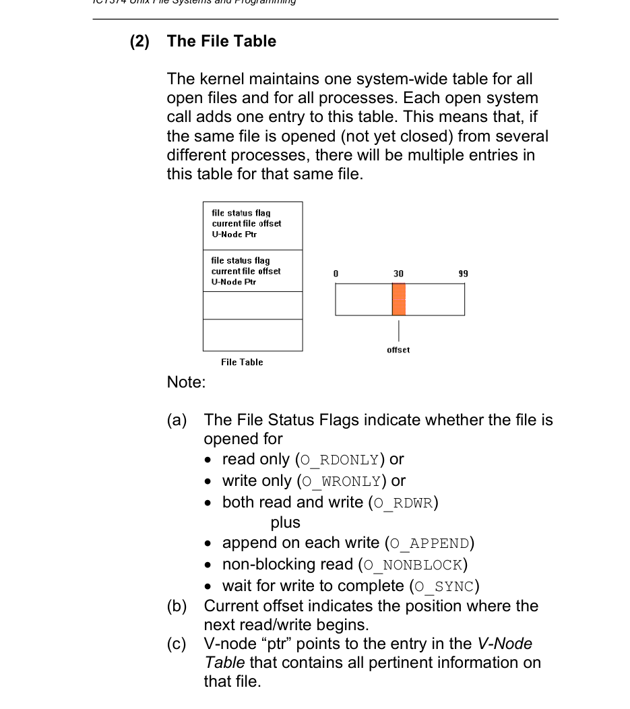
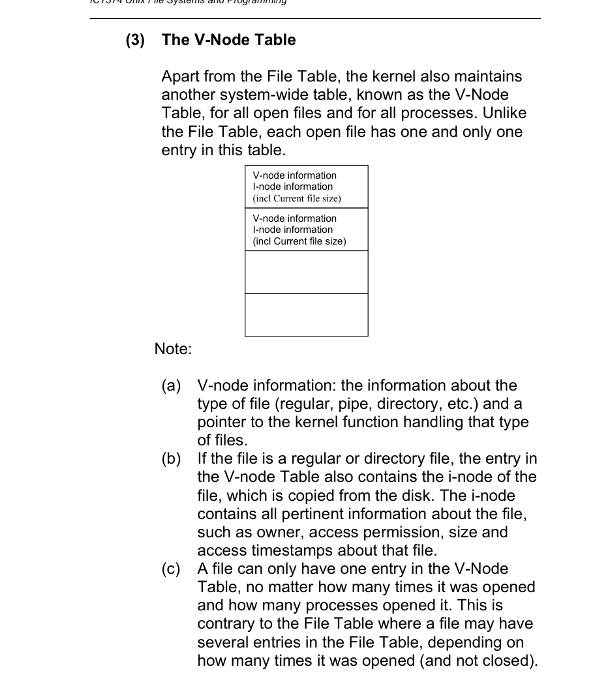
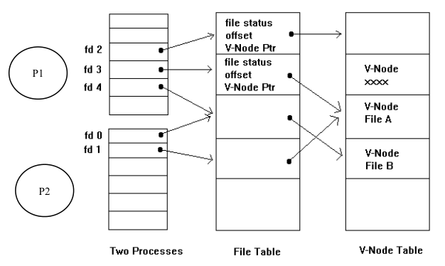
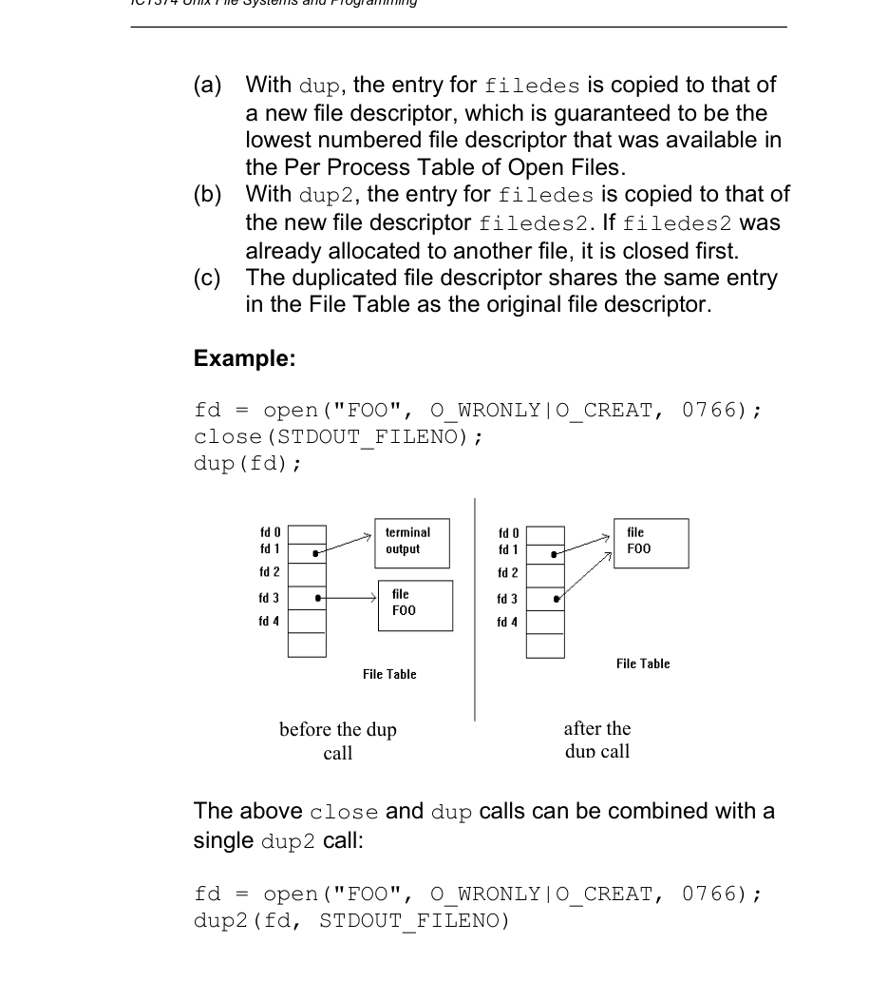
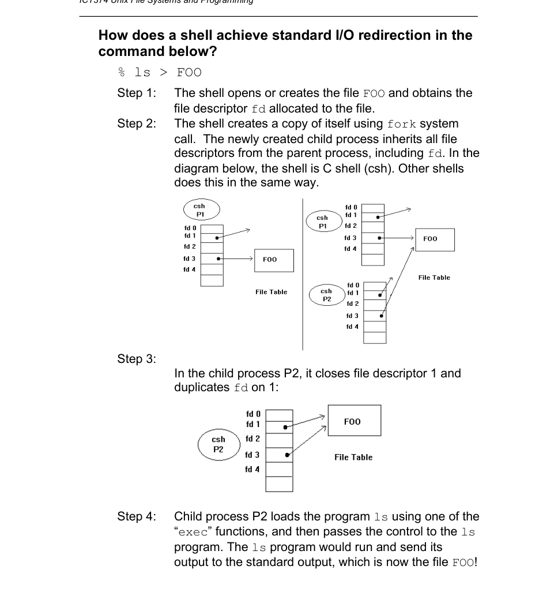
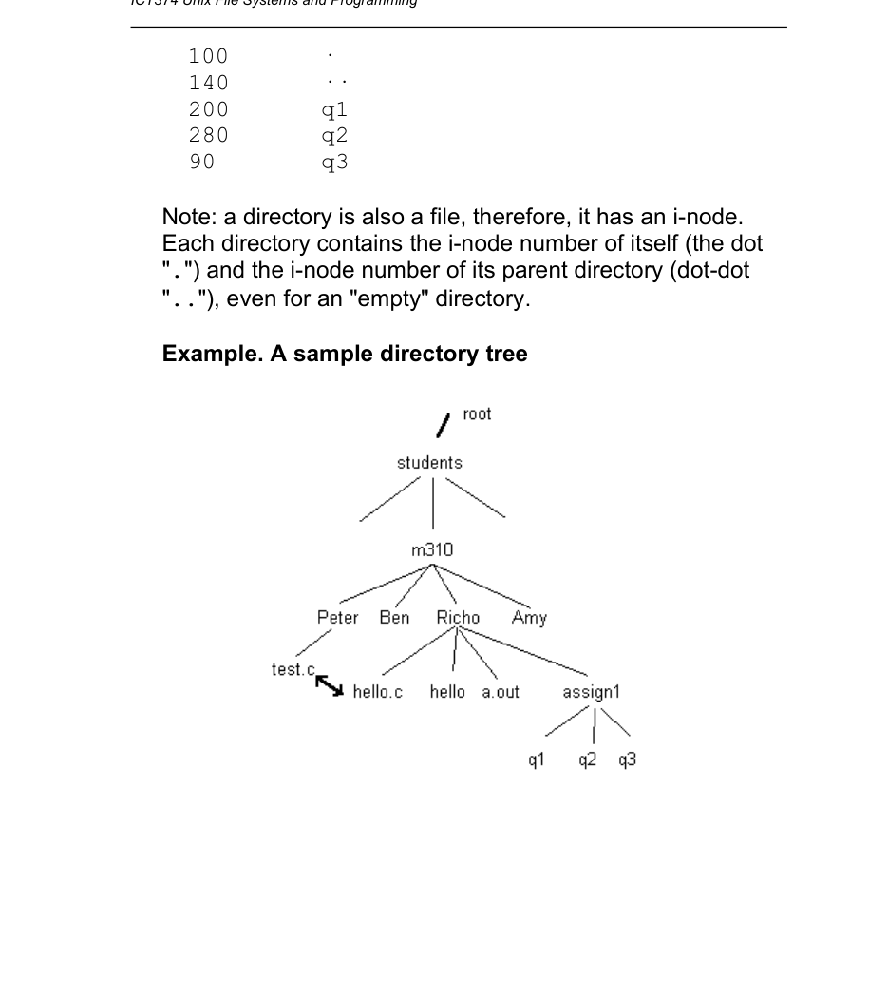
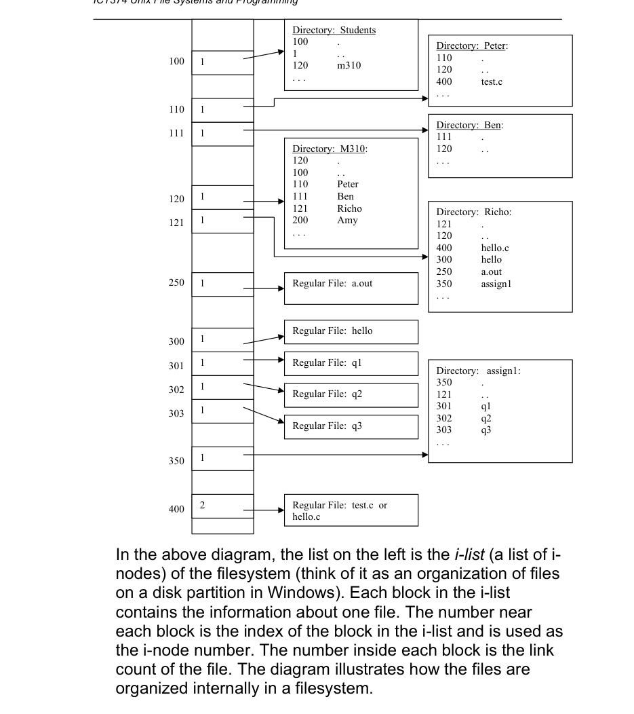
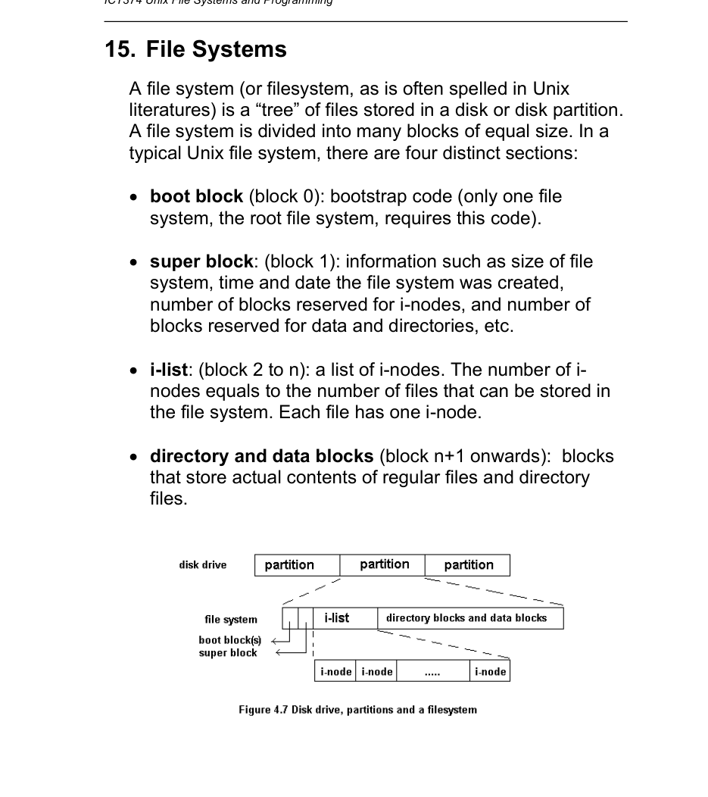

# Topic 05: Unix File Systems and Programming

## Overview
This lecture covers how Unix presents files to programs (a named sequence of bytes), the kernel tables behind open files, the low-level I/O calls (`open`, `read`, `write`, `lseek`, `dup`, `fcntl`), and the on-disk structures (i-nodes, directories, file system layout). It then covers permissions, `umask`, links, `stat`, special files and reading directories. The "standard I/O library" objective is listed on slide 1 but has no slides in this lecture.

## 1. The Unix file abstraction (slide 2)
A file has a name, a sequence of bytes and no other structure (no lines or records). On disk it is stored as fixed-size blocks scattered around the device.

## 2. Kernel data structures for file I/O (slides 3-7)
Opening a file locates it on disk, sets up the kernel structures for sharing it, and returns a file descriptor used by all later reads and writes (not the path). Classic Unix uses three tables (Linux differs in detail but supports the same abstraction):
- **Per-process table of open files**: one per process; the index is the file descriptor. Each entry holds the descriptor flags (POSIX defines only `FD_CLOEXEC`: close on `exec`) and a pointer into the File Table. Descriptors 0, 1, 2 (stdin, stdout, stderr) are open at process creation and point to the terminal.
- **File Table** (system-wide): one new entry per `open` call, even for the same file. Holds the file status flags (`O_RDONLY`, `O_WRONLY`, `O_RDWR`, `O_APPEND`, `O_NONBLOCK`, `O_SYNC`), the current offset, and a v-node pointer.
- **V-node Table** (system-wide): exactly one entry per open file, however many times or by how many processes. Holds the file type, a pointer to the handling functions, and (for regular/directory files) the i-node copied from disk (owner, permissions, size, timestamps).
- **Sharing (slide 7 diagram, two processes P1, P2, files A and B)**: File A is shared via two different File Table entries (each `open`, so independent offsets); File B is shared via the same File Table entry (shared offset and flags, as after `fork` or `dup`). The slide asks what the consequences of these differences are.

## 3. `open` and `close` (slides 8-10)
- `int open(const char *pathname, int oflag, /* mode_t mode */)` adds an entry to the per-process table and File Table; on first open by any process it also creates the v-node entry and copies the i-node. Returns the lowest unused descriptor, or -1.
- `oflag` is exactly one of `O_RDONLY`, `O_WRONLY`, `O_RDWR`, ORed with optional flags: `O_APPEND` (offset to end before each write), `O_CREAT` (create if missing; needs the `mode` argument), `O_EXCL` (with `O_CREAT`, error if exists), `O_TRUNC` (truncate to 0 on write open), `O_NONBLOCK` (return an error rather than wait; FIFOs and device files).
- Examples: `open("foo", O_WRONLY|O_CREAT, 0766)`; `open("foo", O_WRONLY|O_APPEND)`.
- `int close(int fd)` removes the data structures; returns 0 or -1.

## 4. `read` and `write` (slide 11)
- `ssize_t read(int fd, void *buf, size_t nbytes)`: returns bytes read, 0 at end of file, -1 on error. The caller allocates the buffer.
- `ssize_t write(int fd, void *buf, size_t nbytes)`: returns bytes written or -1.
- The slide's `copy` loop reads into `buf[100]` and writes; the slide asks whether it is correct, with a hint about the `write` call (its return value is ignored, and `write` may write fewer bytes than requested).

## 5. I/O efficiency (slide 12)
Disk I/O is done by block, so use a buffer size equal to or a multiple of the block size. Slide table (1,468,802-byte file, 8192-byte blocks): BUFSIZE 1 takes 423.4 s clock time (1,468,802 loops); 64 takes 7.0 s; 1024 takes 0.6 s; 8192 takes 0.3 s (180 loops); beyond that (32768, 131072) there is no further gain.

## 6. `lseek` (slides 13-14)
`off_t lseek(int fd, off_t offset, int whence)` sets the offset and returns it (no I/O happens). A new file starts at offset 0 and each read/write advances it. `SEEK_SET`: offset; `SEEK_CUR`: current + offset; `SEEK_END`: size + offset. `offset` may be negative but the result should not be (for regular files). The test program writes the 26 letters, then seeks to 10, to 16 (`-10` from end), to 6 (`-10` from current) and reads 10 bytes ("ghijklmnop"); the buffer is only a valid string after `buf2[n] = '\0'`.

## 7. `dup`, `dup2` and I/O redirection (slides 15-18)
- Programs are usually filters: input from stdin (fd 0, `STDIN_FILENO`), output to stdout (1), errors to stderr (2). `printf`/`scanf` use these. Redirection works by repointing entries 0/1/2 to another file's File Table entry, with the program unaware.
- `int dup(int fd)`: copies the entry to the lowest free descriptor.
- `int dup2(int fd, int fd2)`: copies the entry to `fd2`, closing `fd2` first if open.
- The duplicate shares the same File Table entry (so the same offset and flags).
- `close(STDOUT_FILENO); dup(fd);` is equivalent to `dup2(fd, STDOUT_FILENO);`.
- How the shell runs `ls > FOO`: (1) shell opens/creates `FOO` and gets `fd`; (2) `fork`, so the child inherits all descriptors; (3) child closes descriptor 1 and duplicates `fd` onto 1; (4) child `exec`s `ls`, whose stdout is now `FOO`.

## 8. `fcntl` (slides 19-21)
`int fcntl(int fd, int cmd, /* int arg */)` changes properties of an already open file.
- `F_DUPFD`: duplicate to the lowest available descriptor >= arg (both share one File Table entry).
- `F_GETFD`/`F_SETFD`: get/set descriptor flags (`FD_CLOEXEC`). Clear with `fcntl(fd, F_SETFD, 0)`.
- `F_GETFL`/`F_SETFL`: get/set status flags. Mask with `O_ACCMODE` to test the access mode; test `O_APPEND`, `O_NONBLOCK`. To set non-blocking: get flags, OR in `O_NONBLOCK`, then set.

## 9. i-nodes and directory files (slides 22-24)
- Each file has one i-node holding everything except the i-node number and the file name: type, permissions, owner/group, size, link count, device number, access/modification/i-node-change times, and data block numbers. A file is identified internally by (device, i-node number).
- A directory is a file mapping names to i-node numbers. It contains `.` (itself) and `..` (parent) even when "empty". Example: directory `assign1` (i-node 100) holds `.`=100, `..`=140, q1=200, q2=280, q3=90.
- Slide 24 diagram: the i-list (indexed by i-node number, each showing the link count) alongside directory contents for a sample tree (Students, M310, Peter, Ben, Richo, assign1). Example: i-node 400 (`test.c`/`hello.c`) has link count 2 as two directories list it.

## 10. Types of file (slide 25)
Characters in `ls -l`: `-` regular, `d` directory, `c` character special, `b` block special, `p` FIFO, `s` socket, `l` symbolic link. Examples shown: `crwx-w---- /dev/ttyp1`, `brw------- /dev/rz3e`, and a symlink from `ln -s m310/tut01.txt tut1.txt`.

## 11. Access permissions (slides 26-28)
- Three sets (owner, group, others) of read/write/execute. Only the owner (and superuser) may change them.
- For a directory: read = list names; write = add/remove entries; execute (search) = access files under it / `cd`.
- Kernel check: if effective user owns the file, use owner bits only; else if effective group matches, group bits only; else other bits only. This uses the process's effective uid/gid, which usually equal the real uid/gid.
- Worked prompt: directory `testdir` with `drwxr-xr--`; decide which operations owner, group and others may perform.
- `int chmod(const char *path, mode_t mode)` and `int fchmod(int fd, mode_t mode)` change the mode; return 0 or -1.

## 12. `umask` (slide 29)
A per-process mask that turns off permission bits on newly created files (a safety measure). Shell: `umask 007` removes all permissions for others. In a program: `mode_t umask(mode_t cmask)` sets it and returns the old mask. To create a file with exactly 0766: `oldmask = umask(0); open("foo", O_RDWR|O_CREAT, 0766); umask(oldmask);`.

## 13. Adding and removing file names (slides 30-32)
- Hard link: another name for the same i-node, same file system only (`ln a b`). `int link(const char *orig, const char *new)`.
- Symbolic link: a separate file holding a path; can cross file systems (`ln -s`). `int symlink(const char *real_name, const char *sym_name)`.
- `open` follows a symlink; `int readlink(const char *path, char *buf, size_t size)` reads the link's own contents (returns bytes, no terminating NUL, so add `buf[n]='\0'`).
- `int unlink(const char *path)` removes a name; `int rename(old, new)` renames; C `remove` also removes empty directories.
- `perror("msg")` prints "msg: <system error message>" to stderr and is preferred over `printf` for errors.

## 14. File information: `stat` (slides 33-36)
- `stat(path, &buf)`, `fstat(fd, &buf)`, `lstat(path, &buf)` fill a `struct stat`. `lstat` differs only for symlinks: it describes the link itself, whereas `stat` describes the target.
- Fields: `st_mode` (type and permissions), `st_ino`, `st_dev`, `st_rdev`, `st_nlink`, `st_uid`, `st_gid`, `st_size`, `st_atime`, `st_mtime`, `st_ctime`, `st_blksize`, `st_blocks`.
- Type test macros on `st_mode`: `S_ISREG`, `S_ISDIR`, `S_ISCHR`, `S_ISBLK`, `S_ISFIFO`, `S_ISLNK`, `S_ISSOCK` (the slide program prints a file's type using `lstat`).
- Permission test by masking with bits such as `S_IRUSR` (00400), `S_IWUSR`, `S_IXUSR`, `S_IRGRP`, ..., `S_IXOTH`. Slide 36 shows the bitwise AND with octal-to-binary for `st_mode = 034755`.

## 15. File systems (slides 37-38)
A file system is a tree of files on a disk or partition, split into equal blocks: boot block (block 0, bootstrap code), super block (block 1: size, creation time, number of i-node and data blocks), i-list (blocks 2..n, one i-node per file), then directory and data blocks. `df` lists mounted file systems and mount points; separate file systems are mounted together into a single tree. Root can mount/unmount; ordinary users may if configured (e.g. `/etc/fstab` entry).

## 16. Caching in file systems (slides 39-40)
Superblocks are cached in kernel memory and read/write data is buffered there, so the disk can be briefly inconsistent. `void sync(void)` schedules a flush of all file systems (returns before completion). `int fsync(int fd)` flushes one file and returns after completion. Shutdown flushes all buffers.

## 17. Special files (slide 41)
Devices are files under `/dev` (e.g. `/dev/ttyp0`) and can be read/written like regular files (permissions permitting), e.g. `ls -l > /dev/tty3`. Each has a major number (device type, selects the driver) and a minor number (which device of that type).

## 18. Reading directories (slides 42-44)
`DIR *opendir(path)`, `struct dirent *readdir(DIR *)` (NULL at end), `rewinddir(dp)` (back to the first entry), `closedir(dp)`. `struct dirent` has `d_ino` and `d_name`. Also `mkdir`, `rmdir`, `getcwd`, `chdir`. The example program lists each entry's name and i-node number for a directory given by `argv[1]` (default ".").

## Key terms
file descriptor; per-process open-file table; File Table; V-node Table; i-node; i-list; directory file; super block; hard link; symbolic link; link count; umask; effective uid/gid; `FD_CLOEXEC`; major/minor device number; sync/fsync; filter; redirection.

## Questions
[Practice questions](../questions/topic-05-questions.md)

## Sources
- Lecture slides ICT374Topic05, slides 1-44 (slide numbers = "Page N of 44").
- APUE (Stevens & Rago) Ch 3 (file I/O), Ch 4 (files and directories); Stallings 12.8 (UNIX file system, i-nodes), pp. 580-584. Used only as background; slide content above is what the lecture covers.
- Note: the diagrams on slides 4-7, 17, 18, 23, 24, 36 and 37 were checked against rendered slide images; the table on slide 12 matches too.
