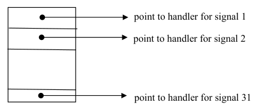

# Topic 06: Signal Handling in UNIX

## Overview
A signal is a software notification of an asynchronous event sent to a process. The lecture covers why signals exist, the signal numbers, how signals are sent, the three possible responses (ignore, default, catch), the old `signal()` function and why it is unreliable, then the POSIX reliable model (`sigaction`, signal sets, `sigprocmask`, `sigpending`). New programs should use the reliable interface, not `signal()`.

## 1. Why signals? (slide 2)
Signals model **asynchronous events**: events that may occur but whose timing is unknown. Examples: CTRL-C, illegal instruction, divide by 0, child terminated, alarm clock expired, illegal memory reference, modem hang-up, terminal window resized.

## 2. How to process asynchronous events (slide 3)
- **Polling**: check the device periodically. Wastes CPU, can still miss an event, may need to poll many devices, hard to write and understand.
- **Interrupt mechanism**: the process runs as if events never occur; when one does, the kernel stops it, runs handler code, then resumes the process. Signals work this way.

## 3. Signals (slide 4)
31 signals, each an integer. Full list is in `<signal.h>`. Slide table:

| Name | No. | Event |
|---|---|---|
| SIGHUP | 1 | modem connection hangs up |
| SIGINT | 2 | interrupt foreground processes (CTRL-C) |
| SIGQUIT | 3 | terminate foreground processes (CTRL-\\) |
| SIGILL | 4 | illegal instruction |
| SIGFPE | 8 | floating point error |
| SIGKILL | 9 | kill (cannot be caught or ignored) |
| SIGSEGV | 11 | invalid memory reference |
| SIGPIPE | 13 | write to pipe no one reads |
| SIGALRM | 14 | alarm clock expires |
| SIGURG | 16 | urgent condition |
| SIGTSTP | 18 | stop foreground processes (CTRL-Z) |
| SIGCHLD | 20 | child process terminates |
| SIGUSR1/2 | 30/31 | user-defined |

(The slide's table is garbled in text extraction; numbers follow the slide's row order. Numbers vary between Unix systems.)

## 4. Sending signals (slide 5)
- Keyboard: CTRL-C = SIGINT, CTRL-\\ = SIGQUIT, CTRL-Z = SIGTSTP, delivered to all foreground process group members.
- Kernel sends some, e.g. SIGALRM.
- Another process: `kill(pid, signo)` system call, or shell `kill -SIGKILL 1001` / `kill -9 1001`.
- Hardware-generated during execution: SIGILL, SIGSEGV.

## 5. Handling signals (slide 6)
On arrival a process may (a) **ignore** it (not possible for SIGKILL), (b) take the **default** action (usually terminate), or (c) **catch** it and run a user-defined handler.
- **Old model**: signal is processed or ignored immediately; if signals arrive faster than they are handled some are lost, so it is **unreliable**.
- **New (reliable) model**: a signal can be **blocked** and later unblocked; it is not lost. More complex interface.
- Use `sigaction` in new code. `signal()` is now implemented on the reliable model but behaves differently across systems.

## 6. Function pointers (slides 7-8)
Needed to read the `signal` prototype.
- `void (*f)(int i);` f is a pointer to a void function taking an int.
- `int ff(int n);` function returning int; `int *ff(int n);` function returning int pointer; `int (*ff)(int n);` pointer to a function returning int.
- A function name without parentheses is its start address (like an array name), so `f = f1; f(100);` calls f1, then `f = f2; f(100);` calls f2.

## 7. Setting a signal handler (slides 9-14)
`void (*signal(int signo, void (*handler)(int)))(int);`
Installs `handler` for `signo` and returns the previous handler. Easier with `typedef void sigfunc(int);` then `sigfunc *signal(int signo, sigfunc *handler);`.

- **Default**: `signal(sig, SIG_DFL)`. Default for most signals is to terminate. E.g. CTRL-C on `top` sends SIGINT, default action ends it; `kill -SIGKILL pid` kills a background `top &`.
- **Ignore**: `signal(sig, SIG_IGN)`. Example 7: ignoring SIGINT means CTRL-C does nothing, but CTRL-\\ (SIGQUIT) still stops the program. Example 8 ignores SIGINT for 20 seconds, then restores SIG_DFL.
- **Catch**: the kernel keeps a per-process **signal table** (in kernel space) holding the handler address for each signal. On arrival the kernel stops the process, looks up the handler, calls it with the signal number as its int argument, and resumes the process when it returns. Special values: `SIG_ERR` (-1, error), `SIG_DFL` (0), `SIG_IGN` (1). Example 9: `signal(SIGINT, catch)` means CTRL-C or `kill -SIGINT pid` prints a message instead of terminating.



## 8. Alarm and pause (slides 15-16)
- `wait(&status)`: suspend until a child terminates.
- `sleep(n)`: suspend for n seconds.
- `alarm(n)`: set alarm clock, return immediately (returns seconds remaining on a previous alarm); kernel sends SIGALRM when it expires.
- `pause()`: suspend until a signal is received and its handler has returned.

Example 10 (`tml`, "tell me later"): parent forks and exits after printing the child's pid; child installs a SIGALRM handler that sets a flag, calls `alarm(nsecs)`, then `pause()`. After waking, it checks the flag, rings the bell and prints the message.

## 9. Unreliable signals (slides 17-18)
Problem: after a signal is caught, should the handler be reset to default?
- **SVR4**: handler reset to default on catch. Fix by re-installing the handler at the start of the handler, but a signal arriving in the window before re-installation triggers the default action (likely termination).
- **4.3BSD**: handler stays installed. Problem: a handler that is not reentrant-safe (e.g. `getStudent()` using shared global `name`/`number` buffers and `fgets`) can be re-entered by a new signal mid-execution and overwrite earlier data.
- Root cause: in the traditional model a signal must be handled immediately or ignored; handling cannot be delayed.

## 10. Reliable signals (slide 19)
Lifetime of a signal:
1. **Generated/sent** when the event occurs.
2. **Delivered** when its action is taken.
3. **Pending** between generation and delivery.

A process may **block** a signal. If a blocked signal's action is default or catch, it stays pending until the process unblocks it or changes the action to ignore.

## 11. Reliable signal interface, POSIX.1 (slides 20-24)
Use `sigaction` rather than `signal` for portability.

**Signal sets** (`sigset_t`): `sigemptyset`, `sigfillset` (empty/full set), `sigaddset`, `sigdelset` (add/remove one signal), all return 0 on success, -1 on error; `sigismember` returns 1 if present, 0 if not. Example 11 builds a set of SIGINT and SIGQUIT.

**`int sigaction(int signo, const struct sigaction *act, struct sigaction *oldact);`** installs the new action; the old one is copied to `oldact` if not NULL.

```c
struct sigaction {
    void (*sa_handler)(int);
    void (*sa_sigaction)(int, siginfo_t *, void *);
    sigset_t sa_mask;
    int sa_flags;
};
```
- Use `sa_handler`, or `sa_sigaction` (three args) when `sa_flags` has `SA_SIGINFO`.
- While a handler runs, further signals of the **same number are automatically blocked**; `sa_mask` lists additional signals blocked during the handler.
- `sa_flags` modifies behaviour, e.g. `SA_RESETHAND` resets to default on entry (SVR4 style). POSIX.1 itself defines only `SA_NOCLDSTOP` (for SIGCHLD, no notice when children stop).

**Example 12**: handler sleeps 4 s; `sa_mask` = full set. CTRL-C pressed three times quickly: handler ran only twice because **POSIX.1 does not queue blocked signals**; multiple blocked occurrences of one signal are kept as one. A following CTRL-\\ (SIGQUIT, not caught) gave "Quit (core dumped)", the default action for SIGQUIT.

## 12. Block and unblock signals (slides 25-29)
Block signals before a critical section and unblock afterward.

**`int sigprocmask(int how, const sigset_t *bset, sigset_t *oldset);`**
- `SIG_SETMASK`: the blocked set becomes `bset`.
- `SIG_BLOCK`: add `bset` to the current blocked set.
- `SIG_UNBLOCK`: remove `bset` from the blocked set.

**Example 13**: block SIGINT and SIGQUIT, "work" for 10 s, then unblock. CTRL-\\ pressed during work only took effect after unblocking (then core dump).

**`int sigpending(sigset_t *set);`** returns the set of signals currently pending. **Example 14** polls it each second with `sigismember` and prints "SIGQUIT is pending" until the section ends and the signal is delivered.

## Key terms
- **Asynchronous event**: may happen at an unpredictable time.
- **Signal handler**: void function taking the signal number.
- **SIG_DFL / SIG_IGN / SIG_ERR**: default action / ignore / error return.
- **Signal table**: per-process kernel table of handler addresses.
- **Generated, delivered, pending**: stages of a signal's life.
- **Blocked**: delivery postponed; signal stays pending.
- **Signal mask**: set of currently blocked signals.
- **Reentrant-safe**: safe to call again while already executing.
- **sigset_t, struct sigaction**: signal set type and handler description.

## Questions
[Practice questions](../questions/topic-06-questions.md)

## Sources
- ICT374 Topic 06 slides 1-29.
- Stevens & Rago (APUE) Ch 10, pp. 313-380 (reading). Edition note: the slides cite Stallings Table 2.6 (p. 124) and Table 6.2 (p. 316), but in the supplied Stallings PDF the UNIX signals table is Table 6.1 on p. 316, and p. 124 is an Android figure page. Not used.
