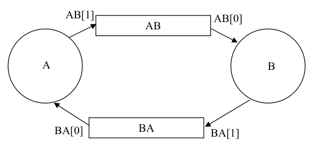
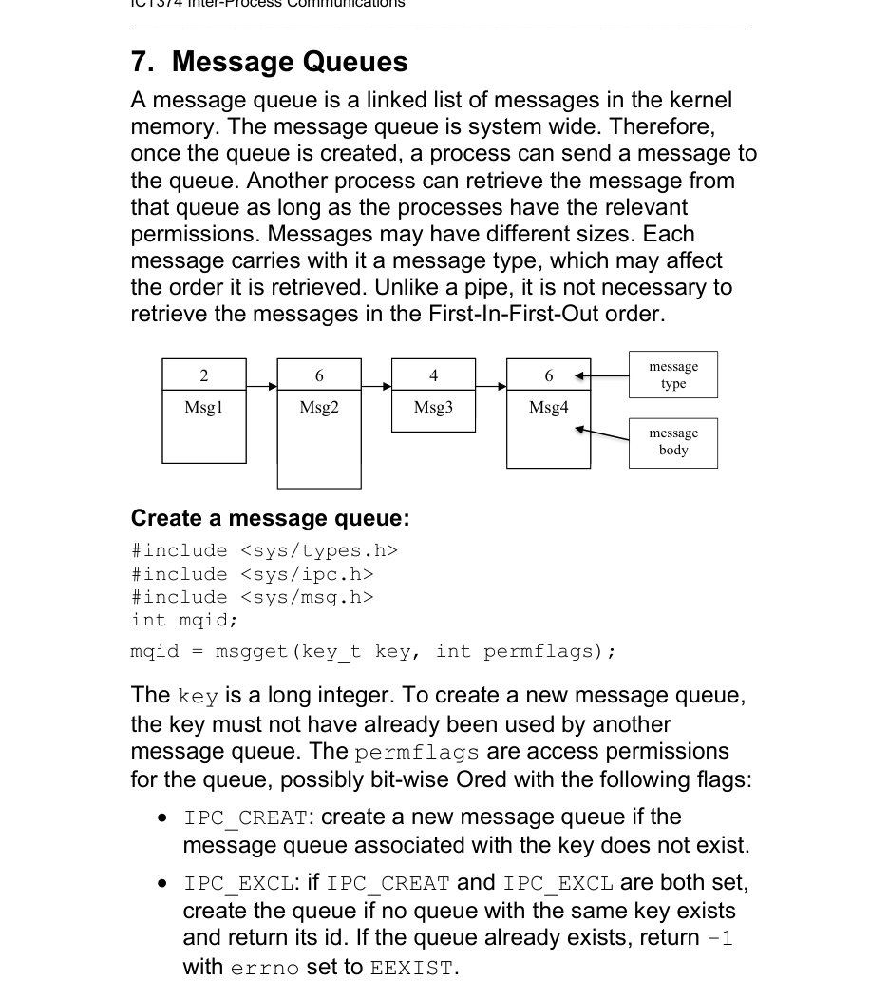
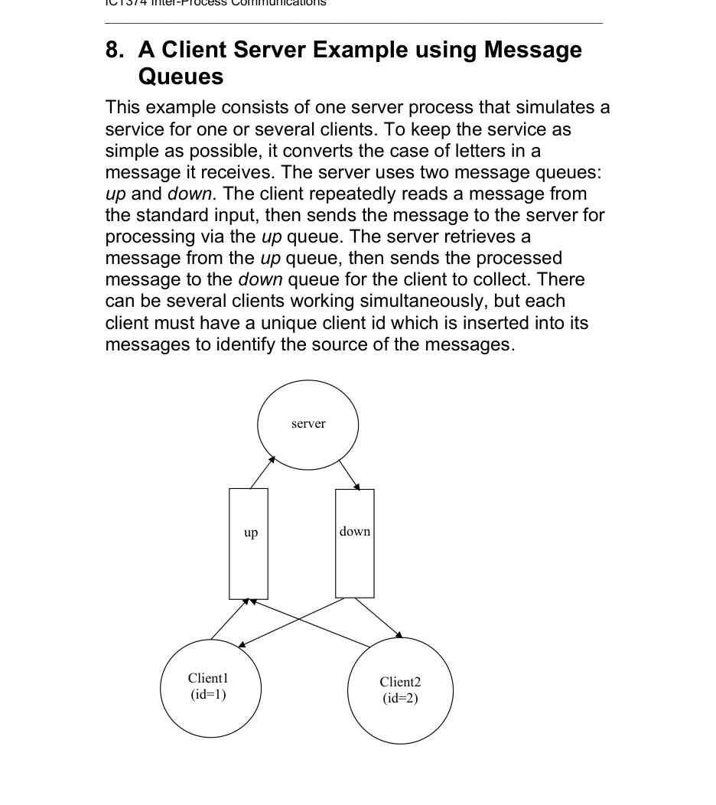
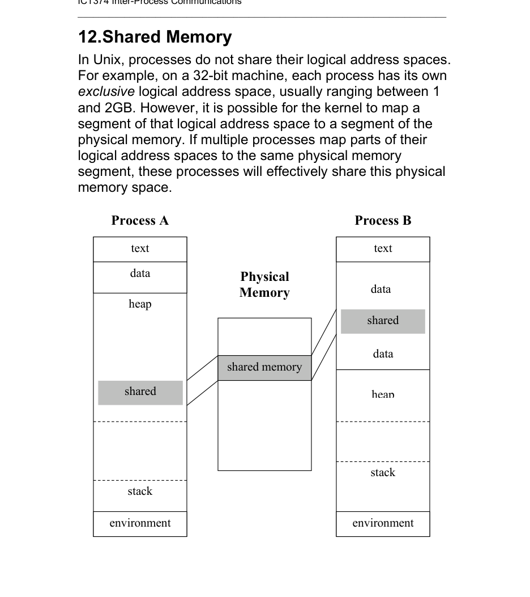

# Topic 07: Inter-Process Communications Mechanisms in Unix

## Overview
Each process has its own virtual address space, so processes cannot simply share variables. Signals carry no data and shared files are too slow, so Unix provides IPC mechanisms. The lecture covers pipes (BSD and System V), FIFOs, and three System V IPCs: message queues, semaphores and shared memory. Sockets (for processes on different machines) are left to Topic 8.

## 1. Introduction (slide 2)
- Pipes and FIFOs: processes on the same computer.
- Stream pipes and named stream pipes: network applications on different computers.
- System V IPCs: message queues, semaphores, shared memory.
- Sockets (BSD and SV) and streams (SV) exist but are outside this topic.

## 2. Pipes (slides 3-6)
- `int pipe(int filedesc[2])` returns 0 on success, -1 on error. `filedesc[0]` is the read end and `filedesc[1]` is the write end.
- A pipe is a one-way channel. It is a kernel FIFO buffer. It only works between processes with a common ancestor, because the descriptors are inherited across `fork`. Several processes may read or write the same pipe.
- Reading an empty pipe blocks. Writing to a full pipe blocks.
- Example 1: one process writes to `p[1]` and reads from `p[0]`.
- Example 2: the pipe must be created before `fork`. The parent writes `p[1]` and the child reads `p[0]`.
- Cleaner interface: each side closes the end it doesn't use (reader closes `p[1]`, writer closes `p[0]`). The data direction can be either way (parent to child or child to parent).

## 3. Size of the pipe and read/write behaviour (slides 7-10)
POSIX requires a buffer of at least 512 bytes. Most systems use more. Behaviour:
- Pipe empty and a writer still connected: `read` blocks.
- Pipe full and a reader still connected: `write` blocks.
- Pipe empty and no writer connected: `read` returns 0 immediately (end of file).
- No reader connected: the writer gets `SIGPIPE`. If the signal is caught or ignored, `write` returns -1. Otherwise the process terminates.

`pipesync.c` (slides 8-9) uses two pipes, `AB` and `BA`, for two-way communication. A (parent) sends a message to B (child) on `AB`. B changes the case of the letters (`conv`) and returns the result on `BA`. Every end that a process doesn't use must be closed, and the writer closes its write end (L2) so B sees end-of-file. Otherwise the program hangs (deadlock) or the reader never gets 0 from `read`. Slide 10 asks what happens if L1, L2 or L3 is removed (see the questions file).

## 4. Non-blocking read and write (slide 11)
Add `O_NONBLOCK` to the descriptor with `fcntl`: `fcntl(fd, F_GETFL, 0)`, OR in `O_NONBLOCK`, then `fcntl(fd, F_SETFL, val)`. Then `read` on an empty pipe, or `write` on a full pipe, returns -1 immediately with `errno == EAGAIN`.

## 5. FIFOs / named pipes (slides 12-13)
- Unnamed pipes only work between related processes and vanish when the processes end. A FIFO is a special file with a name in the file system, so unrelated processes can use it. It is accessed with `open`, `read`, `write` and `close`.
- Create with `mkfifo example.fifo` (shell; mode is 666 & ~umask) or `int mkfifo(const char *pathname, mode_t mode)` (returns 0 or -1).
- Example (slide 13): create `/tmp/example.fifo` (after `unlink`), `fork`. The child opens it `O_RDONLY` and reads. The parent opens it `O_WRONLY` and writes.

## 6. System V IPC in general (slides 14-16)
- **Message queue**: a linked list of typed messages in the kernel. They need not be retrieved in FIFO order.
- **Semaphore**: controls access to shared resources, for mutual exclusion and synchronisation.
- **Shared memory**: a piece of physical memory mapped into several processes' address spaces. It is fast, but access must be controlled, usually with semaphores.
- These are system-wide and persist until explicitly removed. Each object has a **key** (like a pathname) and an **id** (like a file descriptor). The id is allocated at creation. The same key can give different ids at different times. Subsequent accesses use the id. Objects have access permissions, but "execute" is meaningless.
- Command line: `ipcs` lists the objects (key, id, owner, perms, ...). `ipcrm msg 1793` removes one.
- To create an object use an explicit key (shared via a header file, but keys may clash) or `IPC_PRIVATE` (the system picks an unused key, no clashes). With `IPC_PRIVATE` another unrelated process can't find the object. It only suits processes that share an ancestor, which inherit the id across `fork`.

## 7. Message queues (slides 17-19)
- `int mqid = msgget(key_t key, int permflags)` creates or gets a queue. Flags: `IPC_CREAT` creates the queue if it doesn't exist. `IPC_CREAT|IPC_EXCL` fails with -1 and `errno = EEXIST` if it already exists. Example: `msgget(key, 0600 | IPC_CREAT)`.
- `int msgsnd(int mqid, void *message, int size, int flag)`. The message is a struct `{ long mtype; char mtext[...]; }`. `mtype` must be > 0 and `size` is the length of `mtext`. Without `IPC_NOWAIT` the call blocks when the queue is full. With it, the call returns -1 with `EAGAIN`.
- `int msgrcv(int mqid, void *message, int size, long type, int flag)`. `type` selects the message:
  - `type = 0`: the first message in the queue.
  - `type > 0`: the first message whose `mtype == type`.
  - `type < 0`: the first message with the lowest `mtype` that is <= `|type|`.
- Flags: `MSG_NOERROR` truncates an oversize message silently. Without it the call fails with `E2BIG` and the message stays. `MSG_NOWAIT` (the slides' name; the standard flag is `IPC_NOWAIT`) returns -1 with `ENOMSG` instead of blocking.

## 8. Client-server example with message queues (slides 20-25)
- One server and several clients, each with a unique id (1 to `MAXTYPE`). Two queues: `up` (client to server) and `down` (server to client). The server converts the case of each message.
- The client sets `mtype = client id` on send. It receives from `down` with `type = client id`, so each client only collects its own replies.
- The server creates both queues with `IPC_CREAT|IPC_EXCL`, so it fails if they exist. It becomes a daemon (`daemon_init`: `fork`, parent exits, `setsid`, `chdir("/")`, `umask(0)`) and logs to a file. It receives from `up` with `type = -MAXTYPE`, so the lowest client number is served first, and with `MSG_NOERROR`. It handles `EINTR` (retry) and `EIDRM` (queue removed). It sends the result to `down`.

## 9. Semaphores (slides 26-29)
- A semaphore is a shared integer counter (Dijkstra). It has two atomic operations: P/wait (`proberen`; wait until sem > 0, then decrement) and V/signal (`verhogen`; increment and wake waiters). Stallings calls them `semWait` and `semSignal`. The slide definition differs slightly from Stallings' (it wakes all waiters), but the function is similar.
- Mutual exclusion pattern, with the initial value 1 (a binary semaphore): `P(sem); access resource; V(sem)`.
- Ticket-booking example (`bt.c`): several agents run concurrently and each reads `ticket_db`, decrements it and writes it back inside `p(s)`/`v(s)`. The output shows each process's read/update pair running without interleaving, so only one process is in the critical section at a time. The helpers (`getsem`, `rmsem`, `p`, `v`) are in `pv.h`/`pv.c`.

## 10. System V semaphore interface (slides 30-35)
System V semaphores are **arrays** of semaphores, and the operations are general.
- `semget(key, nsems, perflags)` creates or gets a semaphore set. It does **not** set initial values.
- `semctl(semid, sem_num, command, union semun arg)` does many things. With `SETVAL` and `arg.val` it sets the initial value, with `IPC_RMID` it removes the set.
- `semop(semid, struct sembuf *op_array, size_t num_ops)` does atomic operations on several semaphores. `struct sembuf` has `sem_num` (index), `sem_op` and `sem_flg` (`IPC_NOWAIT`, `SEM_UNDO`).
  - `sem_op < 0` is like P. It waits until `semval >= |sem_op|`, or fails with `IPC_NOWAIT`.
  - `sem_op > 0` is like V. It increments and wakes waiters.
  - `sem_op = 0` waits until `semval == 0`.
- `pv.c`: `getsem(key, val)` creates the set (or fetches it if it already exists) and sets the value. `rmsem` removes it. `p`/`v` are `semop` with -1/+1 and `SEM_UNDO`. `p0`/`v0` are the same without `SEM_UNDO`.
- `SEM_UNDO` problem: a process that dies after P but before V would block everyone else. With `SEM_UNDO` the kernel keeps an adjustment value and reverses the process's last operations when it exits. `p0`/`v0` are preferable when the V must survive the process's exit (see slide 39 below).

## 11. Synchronisation: producer-consumer (slides 36-39)
- The buffer holds one item. The producer must not overwrite an unconsumed item, and the consumer must not take the same item twice.
- Two semaphores: `empty = 1` and `full = 0`.
  - Producer, repeated: produce item; `p(empty)`; place item; `v(full)`.
  - Consumer, repeated: `p(full)`; take item; `v(empty)`; consume item.
- `wfile.c` (producer) and `rfile.c` (consumer) use a shared file `data` as the buffer, with 10 items. A third semaphore `end` lets the writer wait (`p0(end)`) until the reader finishes (`v0(end)`) before it removes all the semaphores. The non-undo versions are needed for `end`: with `SEM_UNDO` the reader's V would be undone when the reader exits (the slide asks why, see the questions file).

## 12. Shared memory (slides 40-45)
- The kernel maps part of each process's logical address space to the same physical memory segment, so they share it. The diagram on slide 40 shows two processes (text, data, heap, shared memory, stack, environment), whose shared-memory regions both point to one physical segment. The shared region sits at a different logical position in each process (below the heap in A, between two data areas in B), so the address in each process need not be the same.
- `int shmget(key_t key, size_t size, int permflags)` creates or gets the object (size rounded up to whole pages).
- `void *shmat(int shmid, void *addr, int flags)` attaches it and returns its address. `addr == NULL` lets the kernel choose the address (preferred). `SHM_RDONLY` makes it read-only. `SHM_RND` rounds `addr` down/up to a page boundary (the slide says rounded up). `shmdt` detaches it. `shmctl` does miscellaneous operations (query, change info, `IPC_RMID` removal, lock/unlock).
- Shared memory has no built-in synchronisation, so the writer `wshm.c` and reader `rshm.c` use `empty`/`full` semaphores plus a `reader_end` semaphore, as in the file example but much faster. `wshm` writes ten random numbers into a shared `int`. After the reader's `v0(reader_end)` the writer removes the shared memory (`shmctl(..., IPC_RMID, NULL)`) and the semaphores. Again `v0` is used, because with `SEM_UNDO` the V would be nullified when the reader exits, and the writer would wait forever.

## Key terms
- **Pipe / unnamed pipe**: kernel FIFO buffer between related processes (`pipe`).
- **FIFO / named pipe**: pipe with a file name (`mkfifo`).
- **SIGPIPE**: signal sent when writing to a pipe with no reader.
- **O_NONBLOCK / EAGAIN**: non-blocking mode and its "would block" error.
- **System V IPC**: message queue, semaphore set, shared memory.
- **Key / id**: user-chosen or system-chosen name of an IPC object, and the id handed out at creation. `IPC_PRIVATE`, `IPC_CREAT`, `IPC_EXCL` are the related constants.
- **`ipcs` / `ipcrm`**: list and remove IPC objects.
- **Message type (`mtype`)**: positive tag that selects which message `msgrcv` returns.
- **Semaphore, P/V (wait/signal), binary semaphore**: atomic counter operations for mutual exclusion and synchronisation.
- **`SEM_UNDO`**: undo a process's semaphore operations when it exits.
- **Producer-consumer**: classic synchronisation problem, solved with `empty` and `full`.
- **Shared memory (`shmget`, `shmat`, `shmdt`, `shmctl`)**: one physical segment mapped into several address spaces.

## Questions
[Practice questions](../questions/topic-07-questions.md)

## Sources
- Lecture slides: ICT374 Topic 07 (45 slides). Pipes 3-11, FIFOs 12-13, System V IPC 14-16, message queues 17-19, client-server 20-25, semaphores 26-29, semaphore interface 30-35, producer-consumer 36-39, shared memory 40-45.
- Textbook: APUE (Stevens and Rago) Ch 15, pp. 533-579 (the topic reading). Stallings Ch 5.3-5.7, pp. 244-269 (semaphores, message passing, producer/consumer). The notes follow the slides and use no extra textbook material.
- Note: the diagrams on slides 8, 17, 20, 37 and 40 were checked against rendered slide images.
