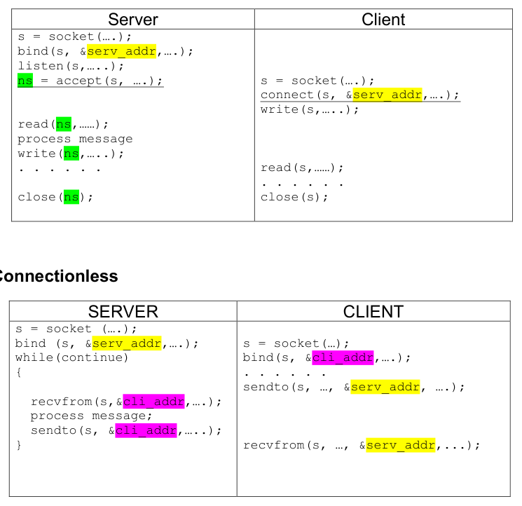
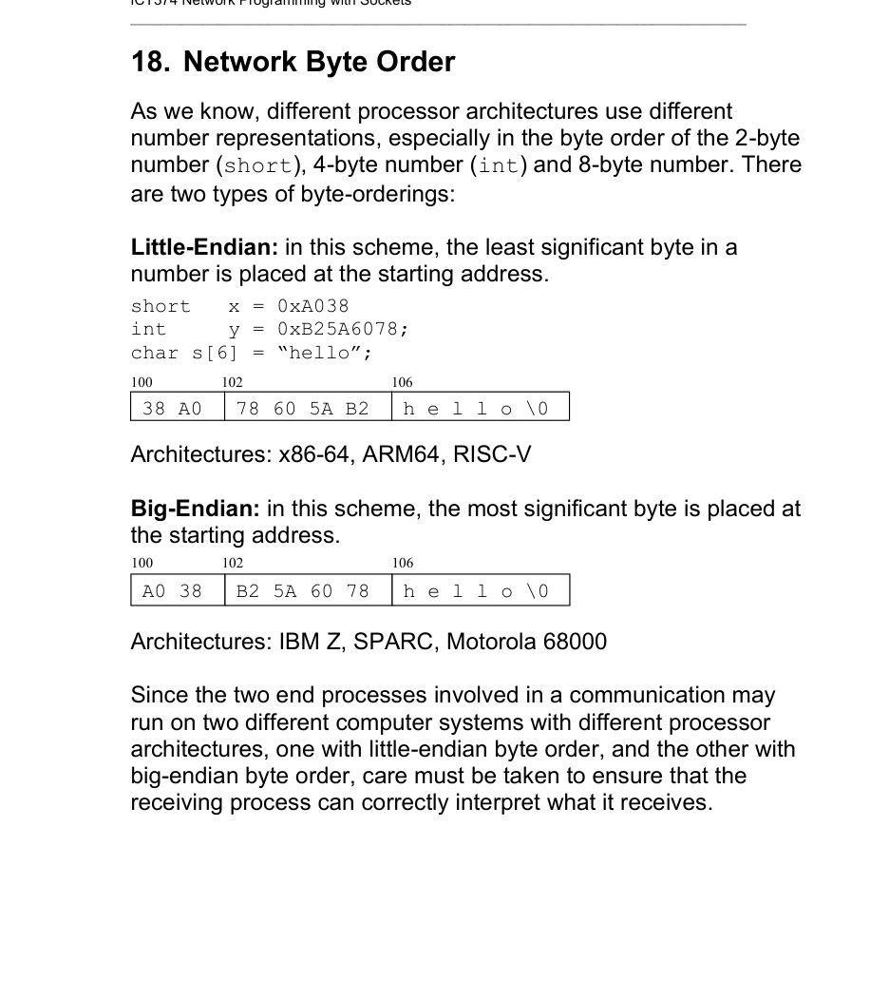
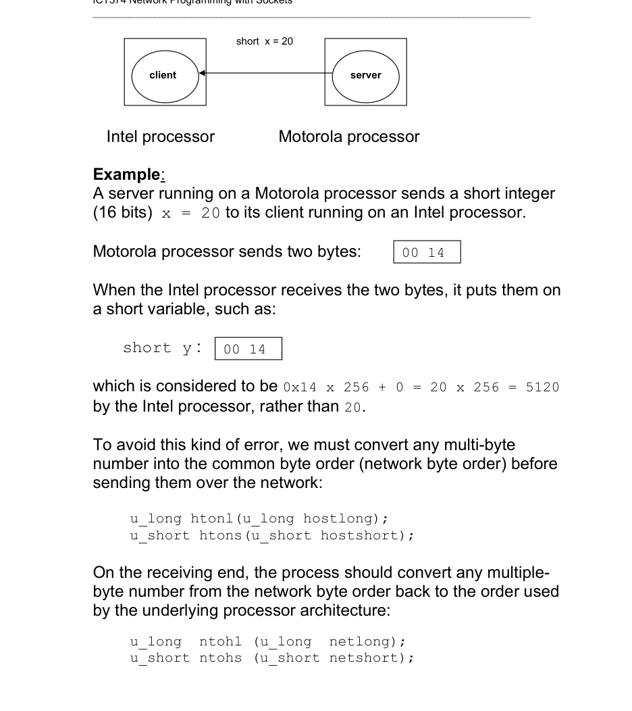
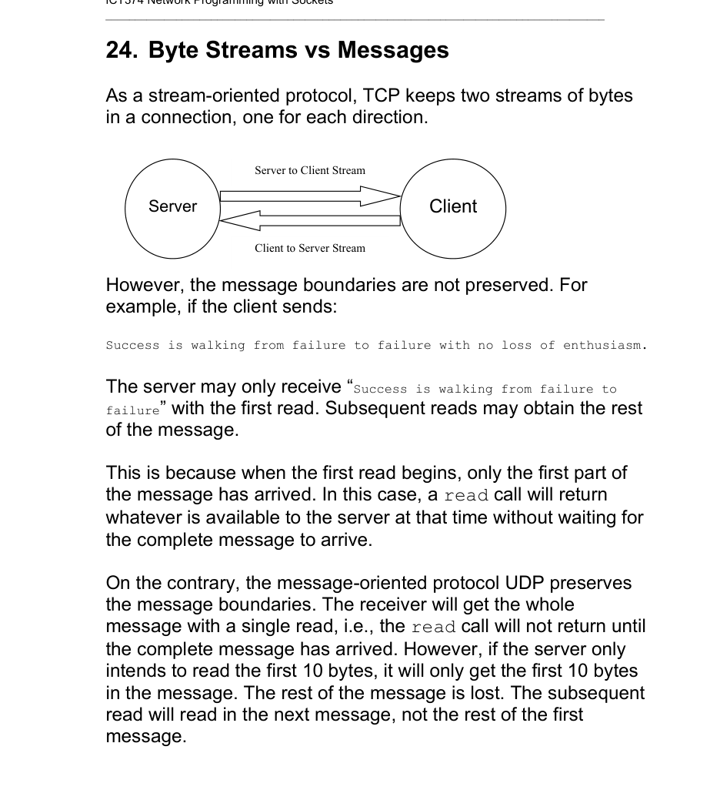

# Topic 08: Network Programming with Sockets

## Overview
The lecture introduces the BSD socket interface for writing client/server programs. The first part covers background (TCP/IP, service modes, addressing). The rest is built around 8 worked examples of a "reverse string" service. Examples 1-3 use Unix domain sockets (same machine only). Examples 4-8 use TCP or UDP. Each example fixes problems in the one before: daemon, concurrent server, zombie children, interrupted calls, byte order, message boundaries, and lost UDP datagrams.

## TCP/IP protocol suite (slides 3-4)
- **TCP**: connection-oriented, reliable (sequencing, flow control, error control), full-duplex, byte-stream. Most Internet applications use it.
- **UDP**: connectionless, no delivery guarantee.
- **ICMP**: error and control information between gateways and hosts; handled by the networking software, not user processes.
- **IP**: packet delivery for TCP, UDP and ICMP; user processes do not normally use it directly.
- **ARP**: Internet address to hardware (e.g. Ethernet) address. **RARP**: the reverse.

## Modes of communication service (slides 5-6)
| Property | TCP | UDP |
|---|---|---|
| Connection | connection-oriented (establish, transfer, terminate; like a phone call) | connectionless / datagram (like letters; each message carries full delivery info) |
| Sequencing (data arrives in send order) | yes | no (packets may take different routes) |
| Error control (corruption via checksum, loss via acknowledgement) | yes | corruption detected, but no guarantee against loss |
| Flow control (sender must not overwhelm receiver) | yes | no |
| Boundaries | byte-stream (no message boundaries) | message-oriented (boundaries preserved) |

## Identifying a process on the Internet (slides 7-8)
- A socket is identified by network ID + host ID (together the 32-bit IPv4 address) + 16-bit port number. TCP and UDP port spaces are separate (TCP 23 differs from UDP 23). IPv6 addresses are 128 bits; ports stay 16 bits.
- Hosts are usually named by domain name. `gethostbyname` resolves it: first `/etc/hosts`, then DNS.
- Well-known ports (assigned by IANA) are 1-1023 (ssh 22, telnet 23, ftp 21, smtp 25, http 80, talk 517/UDP). On Unix only superuser processes may listen on them. Everything else should use ports above 1023.
- `/etc/services` lists service ports; `getservbyname` looks one up by name.

## Programming interfaces (slide 9)
- **Sockets** (BSD): `socket, bind, connect, listen, accept, read, write, send, recv, sendto, recvfrom`.
- **TLI** (System V): `t_open, t_bind, t_connect ...`.
- Both support protocol families beyond TCP/IP (XNS, SNA). Sockets are more popular because Windows adopted them; the unit covers only sockets.

## Socket interface (slides 10-18)
A socket is one end of a communication channel. Each process creates a socket and binds an address to it; both ends must use the same protocol (Unix domain, TCP, UDP, ...). Address formats differ per family (IPv4: 32-bit IP + 16-bit port; Unix domain: a file name), so addresses are passed as the generic `struct sockaddr *` plus a length.

- `int socket(family, type, protocol)`: creates a socket, returns a descriptor.
  - family: `AF_UNIX` (Unix domain), `AF_INET` (TCP/IP), `AF_NS` (Xerox NS).
  - type: `SOCK_STREAM`, `SOCK_DGRAM`, `SOCK_RAW`.
  - protocol: normally 0 (implied): STREAM+AF_UNIX / DGRAM+AF_UNIX = Unix domain protocol; STREAM+AF_INET = TCP; DGRAM+AF_INET = UDP; RAW+AF_INET = IP. Not all combinations are valid (SOCK_RAW with AF_UNIX is not).
- `bind(sd, addr, addrlen)`: assigns a local address to the socket. A server must bind a well-known address ("messages for this address go to this socket"); a client may, but need not.
- `connect(sd, remoteAddr, addrlen)`: for connection-oriented sockets, a slow call that returns after the connection is established. For connectionless sockets it just remembers the destination so `read/write/send/recv` can be used instead of `sendto/recvfrom`.
- `listen(sd, backlog)`: tells the OS the server is ready for connections; `backlog` (usually 5) is how many pending requests may be queued before `accept`.
- `accept(sd, peer, addrlen)`: waits for a connection request; returns a **new socket** for data exchange with that client and fills in the client's address. The original socket keeps listening.
- `send / recv` (and `read / write`) when no peer address is needed; `sendto / recvfrom` when it is. All return bytes transferred (negative on error). With `flag = 0`, `send/recv` act like `write/read`; `MSG_PEEK` lets `recv` look at data without removing it.

**Client/server call sequences** (slide 18):
- Connection-oriented. Server: `socket, bind, listen, accept, read, process, write, close`. Client: `socket, connect, write, read, close`.
- Connectionless. Server: `socket, bind`, loop of `recvfrom`, process, `sendto` (to the address `recvfrom` returned). Client: `socket`, `bind` (its own address, shown on slide 18; slide 11 says a client may omit it), `sendto` server, `recvfrom`.

## Unix domain protocol (slides 19-20)
- An IPC mechanism, not a network protocol: only for processes on the same computer. Its purposes here are another IPC method, practice with socket calls, and showing sockets serve multiple protocol families.
- The address is a file name (like a FIFO). Generic `struct sockaddr {sa_family; sa_data[14]}` is replaced by `struct sockaddr_un {sun_family; sun_path[104]}` (`<sys/un.h>`), cast back to `struct sockaddr *` in calls. Zero it with `bzero`, set `sun_family = AF_UNIX`, copy the path into `sun_path`, then `bind`.

## Example 1: ser1.c / cli1.c (slides 21-22)
Bare-minimum Unix stream pair, deliberately crude. Server: `socket`, `bind`, `listen`, one `accept`, one `read`, one `write` (echo), exit. Client: `socket`, `connect`, `write` a fixed string, `read` the echo, print. Serves one client and one message only.

## Example 2: ser2.c / cli2.c (slides 23-26)
Still Unix stream sockets, with improvements:
- **Daemon** via `daemon_init()`: `fork` and parent exits; child calls `setsid()` (new session leader), `chdir("/")`, `umask(0)`. Hence socket paths must be full (`/tmp/serversoc2`).
- **Reverse string service** instead of echo.
- **Concurrent server**: after `accept`, `fork` a child to serve that client. The parent closes the connected socket `ns` and loops back to `accept`; the child closes the listening socket `s` and loops `read`, reverse, `write` until `read` returns <= 0 (client gone), then exits. Each child handles any number of messages.
- Server does `unlink(sersockname)` before `bind` since the socket file persists.
- Client loops: prompts, `fgets`, strips newline, sends, prints reply, terminates on "quit".

## Example 3: ser3.c / cli3.c (slides 27-29)
Unix **datagram** sockets. The server is **iterative** (serves one message at a time, possibly from different clients): `recvfrom` gets message and client address, reverse, `sendto` that address. The client must `bind` its own address (`/tmp/clientsoc3`) so the server has somewhere to reply, then uses `sendto` and `recv`; it `unlink`s its socket file on quit.

## Internet socket address (slide 30)
`struct sockaddr_in` (`<netinet/in.h>`): `sin_family` (`AF_INET`), `sin_port` (16-bit), `sin_addr` (a struct holding the 32-bit `s_addr`), `sin_zero[8]` unused. Port and IP must be in **network byte order**.

## Network byte order (slides 31-33)
- **Little-endian**: least significant byte at the lowest address (x86-64, ARM64, RISC-V). **Big-endian**: most significant byte first (IBM Z, SPARC, Motorola 68000). Example: `short x = 0xA038` is stored `38 A0` (little) or `A0 38` (big).
- If a big-endian host sends the short 20 (bytes `00 14`) to a little-endian host, the receiver reads 0x1400 = 5120.
- Fix: convert to network (big-endian) order before sending and back after receiving.
  - `htonl` / `htons`: host-to-network long (32-bit) / short (16-bit).
  - `ntohl` / `ntohs`: network-to-host.
  - 64-bit: `htobe64`, `be64toh`, `htole64`, `le64toh` (Linux/BSD, not standardised).
- Used when filling addresses: `sin_port = htons(4000)`, `s_addr = htonl(...)`.

## Example 4: ser4.c / cli4.c (slides 34-37)
Example 2 over **TCP** (`AF_INET, SOCK_STREAM`), so server and client can be on different machines. Server IP (134.115.64.72 = 2255700040) and port 40000 are hard-coded in both. Same structure: daemon, `bind`, `listen`, `accept`, `fork` per client, `serve_a_client` loop.

## Problems in Example 4 (slides 38-42)
1. **Hard-coded server IP**: bind with `htonl(INADDR_ANY)` so the server accepts connections on any network interface of the host (e.g. a host with two Ethernet cards).
2. **Hard-coded IP in client**: the client takes the server host name on the command line and calls `gethostbyname(hostname)` (checks `/etc/hosts`, then name server). It returns a `struct hostent` (`h_name, h_aliases, h_addrtype, h_length, h_addr_list`; `h_addr` = first address). Use `ser_addr.sin_addr.s_addr = *(u_long *)hp->h_addr;`, already in network byte order, so no `htonl`.
3. **Zombies**: a concurrent server's children end when their clients do; if the parent never claims them they remain zombies, using process table slots. Fix: catch `SIGCHLD` in the listening server and `waitpid(0, NULL, WNOHANG)` in a loop (`claim_children`) to reap all finished children. Install with `sigaction`, `sigemptyset(&act.sa_mask)`, and `SA_NOCLDSTOP` so stopped (not terminated) children do not trigger it.
4. **Interrupted slow calls**: `accept` and `read` can be interrupted by a signal and return -1 with `errno == EINTR`. Check for `EINTR` and `continue` (retry) rather than treating it as fatal.

## Example 5: ser5.c / cli5.c (slides 43-46)
The "much improved" Example 4: port 40001, `INADDR_ANY`, SIGCHLD handler installed in `daemon_init`, `EINTR` check around `accept`, client takes an optional host name argument (default `localhost`) and uses `gethostbyname`. Still imperfect (does not yet handle message boundaries).

## Some useful functions (slides 47-51)
- **Address conversion** (`<arpa/inet.h>`): `inet_addr("134.115.64.72")` returns the 32-bit value 2255700040; `inet_ntoa(struct in_addr)` returns the dotted-decimal string.
- **Socket addresses**: `getsockname(sd, addr, len)` gives the address bound to the local socket; `getpeername(sd, addr, len)` gives the remote end's address.
- **Standard ports**: `/etc/services` (name, port/protocol); avoid those ports for your own server. `getservbyname("ftp", "tcp")` returns a `struct servent` (`s_name, s_aliases, s_port` already in network byte order, `s_proto`); print with `ntohs(sp->s_port)`.
- **Byte operations** for binary data that may contain `'\0'`: `bzero(dest, n)`, `bcopy(src, dest, n)`, `bcmp(p1, p2, n)` (counterparts of `strcpy`, `strcmp`). Example: copying a `struct person {char name[40]; short age;}` into a buffer with `bcopy`; `strcpy` would stop at the first null byte.

## How to send numbers (slide 52)
Convert to network order before `write` and back after `read`: sender `nn = htonl(n)` (or `htons` if `sizeof(int)==2`) and `write(sd, &nn, sizeof(n))`; receiver `read(sd, &nn, ...)` then `n = ntohl(nn)`.

## Byte streams vs messages (slides 53-54)
- TCP keeps two byte streams per connection (one each way) but **does not preserve message boundaries**: a single `read` may return only the part of a message that has arrived so far; later reads return the rest.
- UDP preserves boundaries: a read returns a whole message. If the buffer is smaller (e.g. read 10 bytes), the rest of that message is lost and the next read gets the next message.
- Same principle applies to `write`. Example 6 demonstrates the stream effect; Example 7 fixes it with `stream.h`/`stream.c` (`readn`, `writen`).

## Example 6: ser6.c / cli6.c (slides 55-58)
Client sends messages of user-chosen size (10, 100, 1000, 10000 bytes...) over TCP; the server `read`s, reverses, and `write`s back, printing how many bytes each step handled. The sample run shows a 10000-byte message arriving in pieces at the server (1460, 1460, 1460, 1460, 2920, 1240 bytes), and the client's single `read` getting only 1460 bytes of the reply. So one `write` does not equal one `read`.

## Example 7: ser7.c / cli7.c, reverse string protocol (slides 59-65)
- **Protocol**: client sends a null-terminated ASCII string; server replies with the reversed string, until the client closes. Each message = header + string. Header is a 2-byte two's-complement integer in network byte order giving the total string length including the null. Client always initiates; messages at most 1024*5 bytes; server uses TCP port 40003.
- `int writen(fd, buf, nbytes)`: writes the 2-byte length (via `htons`) then loops `write` until all `nbytes` are sent. Returns `nbytes`, -3 if too big, otherwise a write error.
- `int readn(fd, buf, bufsize)`: needs `bufsize >= MAX_BLOCK_SIZE` (else -3); reads the 2-byte length, converts with `ntohs`, then loops `read` until the whole message is in `buf`. Returns bytes read, 0 for connection closed, -1 read error, -2 protocol error, -3 buffer too small.
- ser7/cli7 are ser5/cli5 with `readn`/`writen` in place of `read`/`write`. Build: `gcc -o ser7 ser7.c stream.c`. ser7 also uses `syslog.h`.

## Error recovery in UDP (slides 66-72)
- UDP can lose messages, so `sendto` followed by `recv` can block forever if the request or the reply is lost.
- Method: set a timeout with `alarm(interval)` before each `recv`; a `SIGALRM` interrupts `recv` (returns -1, flag `alarm_expired` set by the handler). On timeout, double `interval` and resend, up to `MAX_RETRY` tries.
- Duplicates are possible (the original reply may arrive after a resend), so each message has a header with a 2-byte `message_no` and 2-byte `retry_no` (4 bytes, network order, in front of the body). The server does not change the header (it reverses only `buf+4`, `n-4` bytes) and returns it; the client discards any reply whose `message_no` is not the current message.
- **Example 8 (ser8.c / cli8.c)**: UDP server is an iterative `recvfrom`/`sendto` loop on port 40001. The client loop: build header, `sendto`, `alarm`, `recv`; on reply `alarm(0)` and check the message number; after `MAX_RETRY` (10) failures, report "message lost". The sample run shows retries (retry_no 2, 3) for lost messages, with the interval starting at 1 second and doubling.

## Key terms
- **Connection-oriented / connectionless**: TCP vs UDP service models.
- **Byte stream / message-oriented**: no boundaries (TCP) vs boundaries preserved (UDP).
- **Well-known port**: 1-1023, assigned by IANA, root only to listen.
- **Socket**: communication endpoint identified by IP + port.
- **Unix domain socket**: same-host IPC addressed by a file name.
- **Concurrent vs iterative server**: forks a child per client vs serves one at a time.
- **Daemon**: background process detached from the terminal (`fork`, `setsid`, `chdir("/")`, `umask(0)`).
- **Zombie**: terminated child not yet reaped; avoided with a SIGCHLD handler and `waitpid(..., WNOHANG)`.
- **Slow system call / EINTR**: call such as `accept` or `read` interrupted by a signal.
- **Network byte order**: big-endian; `htons/htonl/ntohs/ntohl`.
- **INADDR_ANY**: bind to all local network interfaces.
- **readn / writen**: length-prefixed read and write loops that restore message boundaries over TCP.

## Questions
[Practice questions](../questions/topic-08-questions.md)

## Sources
- Lecture slides: ICT374Topic08, slides 1-72 (slide numbers as above; Slide 1 objectives, Slide 2 notes to students).
- APUE Ch 16 (pp. 589-628) and 17.2 (pp. 629-635), Stallings Ch 17.2-17.3 (pp. 17-5 to 17-15): consulted only to clarify, content follows the slides.
