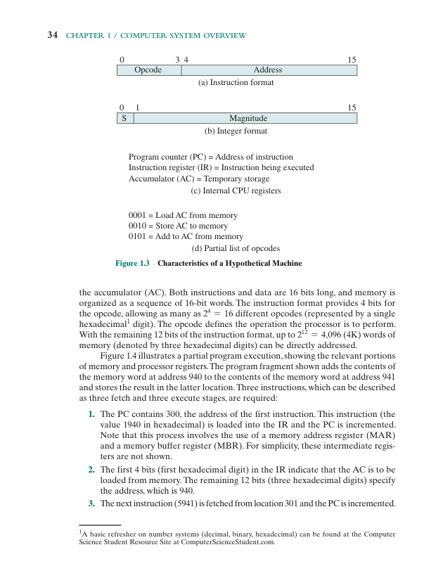
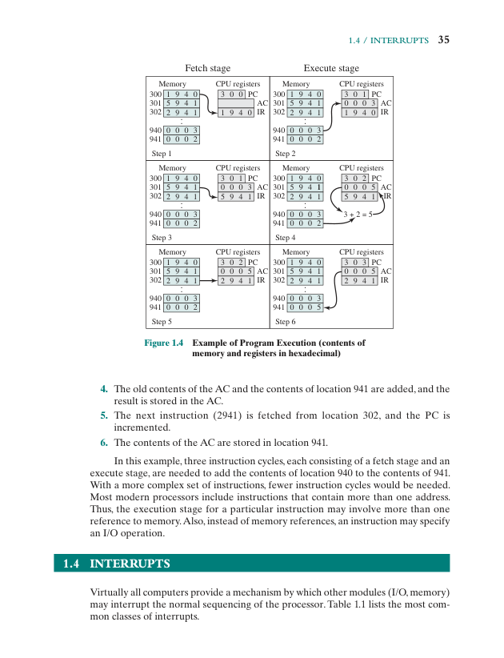

# Topic 1: Computer System Overview - Questions

[Back to summary](../notes/topic-01.md)

The lecture slides contain no explicit questions or exercises.

## Textbook
### Q1. List and briefly define the four main elements of a computer.
Source: Stallings Ch 1, Review Question 1.1, p. 59

### Q2. Define the two main categories of processor registers.
Source: Stallings Ch 1, Review Question 1.2, p. 59

### Q3. In general terms, what are the four distinct actions that a machine instruction can specify?
Source: Stallings Ch 1, Review Question 1.3, p. 59

### Q4. What is an interrupt?
Source: Stallings Ch 1, Review Question 1.4, p. 59

### Q5. How can multiple interrupts be serviced by setting priorities?
Source: Stallings Ch 1, Review Question 1.5, p. 59

### Q6. What characteristics are observed while going up the memory hierarchy?
Source: Stallings Ch 1, Review Question 1.6, p. 59

### Q7. What is the distinction between spatial locality and temporal locality?
Source: Stallings Ch 1, Review Question 1.9, p. 59

### Q8. In general, what are the strategies for exploiting spatial locality and temporal locality?
Source: Stallings Ch 1, Review Question 1.10, p. 59

### Q9. Suppose the hypothetical processor of Figure 1.3 also has two I/O instructions:

0011 = Load AC from I/O
0100 = SUB from AC

In these cases, the 12-bit address identifies a particular external device. Show the program execution (using the format of Figure 1.4) for the following program:
1. Load AC from device 7.
2. SUB from AC contents of memory location 880.
3. Store AC to memory location 881.

Assume that the next value retrieved from device 7 is 6 and that location 880 contains a value of 5.

(Refers to Figure 1.3, p. 34, and Figure 1.4, p. 35.)





Source: Stallings Ch 1, Problem 1.1, p. 59

### Q10. The program execution of Figure 1.4 is described in the text using six steps. Expand this description to show the use of the MAR and MBR.


Source: Stallings Ch 1, Problem 1.2, p. 59

### Q11. Consider a hypothetical 64-bit microprocessor having 64-bit instructions composed of two fields. The first 4 bytes contain the opcode, and the remainder an immediate operand or an operand address.
a. What is the maximum directly addressable memory capacity?
b. What ideal size of microprocessor address buses should be used? How will system speed be affected for data buses of 64 bits, 32 bits and 16 bits?
c. How many bits should the instruction register contain if the instruction register is to contain only the opcode, and how many if the instruction register is to contain the whole instruction?

Source: Stallings Ch 1, Problem 1.3, p. 59

### Q12. Consider a hypothetical microprocessor generating a 16-bit address (e.g., assume the program counter and the address registers are 16 bits wide) and having a 16-bit data bus.
a. What is the maximum memory address space that the processor can access directly if it is connected to a "16-bit memory"?
b. What is the maximum memory address space that the processor can access directly if it is connected to an "8-bit memory"?
c. What architectural features will allow this microprocessor to access a separate "I/O space"?
d. If an input and an output instruction can specify an 8-bit I/O port number, how many 8-bit I/O ports can the microprocessor support? How many 16-bit I/O ports? Explain.

Source: Stallings Ch 1, Problem 1.4, p. 59

### Q13. Consider a 64-bit microprocessor, with a 32-bit external data bus, driven by a 16 MHz input clock. Assume that this microprocessor has a bus cycle whose minimum duration equals four input clock cycles. What is the maximum data transfer rate across the bus that this microprocessor can sustain in bytes/s? To increase its performance, would it be better to make its external data bus 64 bits or to double the external clock frequency supplied to the microprocessor? State any other assumptions you make and explain. Hint: Determine the number of bytes that can be transferred per bus cycle.
Source: Stallings Ch 1, Problem 1.5, p. 60

### Q14. Consider a computer system that contains an I/O module controlling a simple keyboard/printer Teletype. The following registers are contained in the CPU and connected directly to the system bus:

INPR: Input Register, 8 bits
OUTR: Output Register, 8 bits
FGI: Input Flag, 1 bit
FGO: Output Flag, 1 bit
IEN: Interrupt Enable, 1 bit

Keystroke input from the Teletype and output to the printer are controlled by the I/O module. The Teletype is able to encode an alphanumeric symbol to an 8-bit word and decode an 8-bit word into an alphanumeric symbol. The Input flag is set when an 8-bit word enters the input register from the Teletype. The Output flag is set when a word is printed.

a. Describe how the CPU, using the first four registers listed in this problem, can achieve I/O with the Teletype.
b. Describe how the function can be performed more efficiently by also employing IEN.

Source: Stallings Ch 1, Problem 1.6, p. 60

### Q15. In virtually all systems that include DMA modules, DMA access to main memory is given higher priority than processor access to main memory. Why?
Source: Stallings Ch 1, Problem 1.7, p. 60

### Q16. A DMA module is transferring characters to main memory from an external device transmitting at 10800 bits per second (bps). The processor can fetch instructions at the rate of 1 million instructions per second. By how much will the processor be slowed down due to the DMA activity?
Source: Stallings Ch 1, Problem 1.8, p. 60

### Q17. A computer consists of a CPU and an I/O device D connected to main memory M via a shared bus with a data bus width of one word. The CPU can execute a maximum of 10^6 instructions per second. An average instruction requires five processor cycles, three of which use the memory bus. A memory read or write operation uses one processor cycle. Suppose that the CPU is continuously executing "background" programs that require 95% of its instruction execution rate but not any I/O instructions. Assume that one processor cycle equals one bus cycle. Now suppose that very large blocks of data are to be transferred between M and D.
a. If programmed I/O is used and each one-word I/O transfer requires the CPU to execute two instructions, estimate the maximum I/O data transfer rate, in words per second, possible through D.
b. Estimate the same rate if DMA transfer is used.

Source: Stallings Ch 1, Problem 1.9, p. 60

### Q18. Consider the following code:

```
for (i = 0; i < 20; i++)
   for (j = 0; j < 10; j++)
      a[i] = a[i] * j
```
a. Give one example of the spatial locality in the code.
b. Give one example of the temporal locality in the code.

Source: Stallings Ch 1, Problem 1.10, p. 60

## Sample exam
### Q19. An interrupt can be triggered by
a. Multiply by zero
b. Initiation of a disk read
c. Completion of a disk read
d. Output to the terminal screen

Source: Sample exam, Part I Q 1

### Q20. The four basic elements of a computer are
a. Processor, main memory, I/O modules and system bus
b. Main memory, processor, hard disk, and keyboard
c. Processor, DMA, system bus, and I/O devices
d. CPU, peripheral devices, operating system, application software

Source: Sample exam, Part I Q 2

### Q21. A disk cache
a. Is a small disk
b. Is a fast disk
c. Is created in the main memory
d. Is created in the secondary memory

Source: Sample exam, Part I Q 6

### Q22. (10 marks) Briefly describe the four types of interrupts.
a) Program
b) Timer
c) Clock
d) Hardware failure

Source: Sample exam, Part III Q 1
