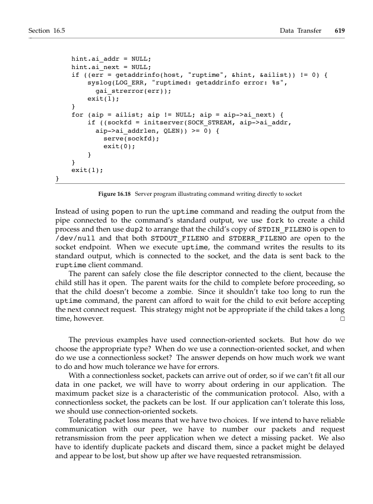

# Topic 08: Network Programming with Sockets - Questions

[Back to summary](../notes/topic-08.md)

## Lecture slides
### Q1. Note: We cannot use strcpy to do the job (why?).
Context: copying `struct person { char name[40]; short age; }` (with `strcpy(p.name, "Kathy Freeman"); p.age = 20;`) into `char buf[BUFSIZE]` using `bcopy((char *) &p, buf, sizeof(p));`.
Source: Slide 51

## Textbook
### Q2. What is TCP/IP?
Source: Stallings Ch 17, Review Question 17.5, p. 17-19

### Q3. What is the purpose of the Sockets interface?
Source: Stallings Ch 17, Review Question 17.6, p. 17-19

### Q4. Write a program to determine your system's byte ordering.
Source: APUE Ch 16, Exercise 16.1, p. 628

### Q5. Write a client program and a server program to return the number of processes currently running on a specified host computer.
Source: APUE Ch 16, Exercise 16.4, p. 628

### Q6. In the program in Figure 16.18, the server waits for the child to execute the uptime command and exit before accepting the next connect request. Redesign the server so that the time to service one request doesn't delay the processing of incoming connect requests.
Depends on Figure 16.18 (APUE p. 619).

Source: APUE Ch 16, Exercise 16.5, p. 628

## Sample exam
### Q7. Which of the following statements about UDP is false?
a. UDP is a connectionless protocol
b. UDP preserves message boundaries
c. UDP provides sequencing
d. UDP incurs less overhead compared with TCP
e. None of the above
Source: Sample exam, Q19 (Part I)

### Q8. In a network application using TCP, what is the system call accept used for?
a. The client uses the system call to receive a message from the server
b. The server uses the system call to receive a message from the client
c. The client uses the system call to wait for a server connection request
d. The server uses the system call to wait for a client connection request
Source: Sample exam, Q20 (Part I)

### Q9. In a network application using TCP, what is the system call bind used for?
a. The client must use the system call to bind an address to the client socket
b. The server must use the system call to bind an address to the server listening socket
c. The client and server use the system call to bind each other
d. A TCP application does not have to use the system call
Source: Sample exam, Q21 (Part I)
